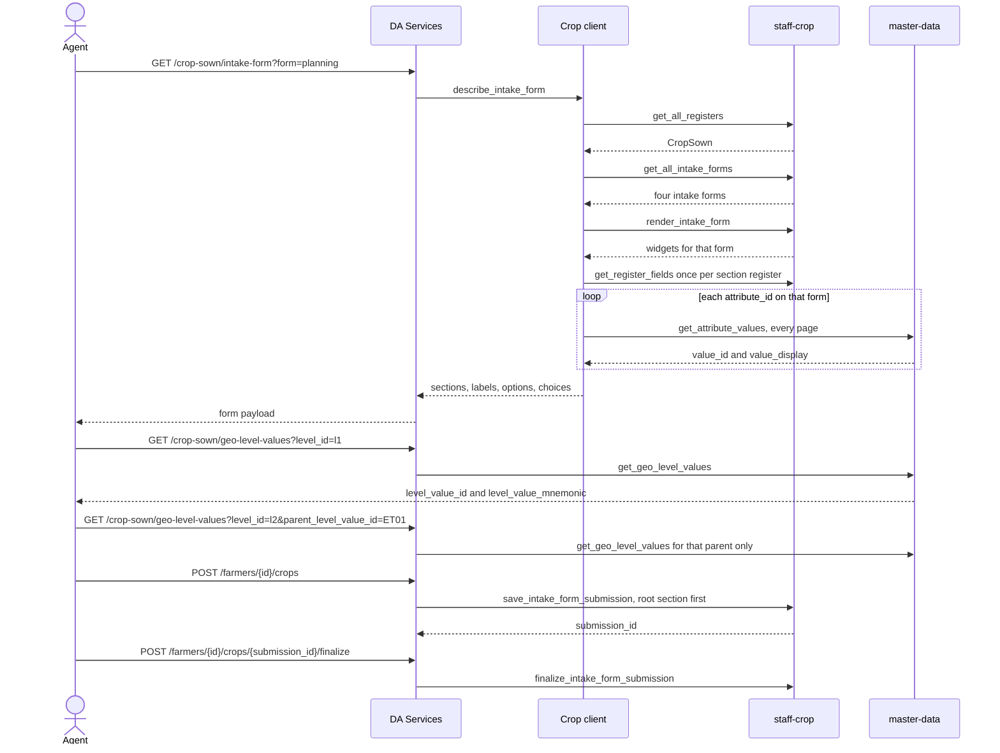

# Crop Sown integration

DA Services does not store Crop Sown records. The Crop Report screen calls DA Services. DA Services checks the caller's role, then calls the Crop Sown staff host. Catalog rows and geography come from the master-data host.

There is no Crop Sown ingest API. A draft is `save_intake_form_submission`, one section at a time. Finalize is a separate call.

The planning form was read from Postman run `58813371-a25cffbb-4cc0-4ab5-8376-0f83e311ea5b` on 2026-10-30. Cultivation, sowing, and harvesting are separate intake forms on the same CropSown register. Their widgets were not in that run. The client renders the form the caller names. It does not copy their fields from the planning form.

## Hosts

| Config key | Development value |
| --- | --- |
| `crop_registry_staff_url` | `https://staff-crop.development.oanstaging.com` |
| `crop_registry_master_data_url` | `https://master-data.development.oanstaging.com` |
| `crop_registry_backend` | `http` on the site that serves the Crop Report. `mock` is the local default. |

`config.example.json` keeps `crop_registry_backend` as `mock`. A copied example does not log in to staff. The serving site must set `http`, the staff URL, the staff username and password, and the master-data URL. An empty master-data URL leaves `catalog_loaded: false` and refuses the geography route.

Login is once per worker, through `da_services/integrations/staff_api`. Later calls reuse the bearer and the matching `X-CSRF-Token` cookie. The envelope sender is `OAN_REGISTRY_API_TEST`. Page size is 100.

## What the screen tabs are

The Crop Report page has five tabs. The staff register has four intake forms.

| Screen tab | Staff form | Query `form` |
| --- | --- | --- |
| Crop Sown (identity, season, location) | Crop planning intake | `planning` |
| Planning | Crop planning intake | `planning` |
| Cultivation / Land Preparation | Crop cultivation intake | `cultivation` |
| Sowing, including infestation when that form contains it | Crop sowing intake | `sowing` |
| Harvesting | Crop harvesting intake | `harvesting` |

`planning` is the default, from `crop_registry_form_name_contains`. Identity and location are sections of the planning form, verified on the planning run. They are not a fifth form.

## Calls for one open form

Do not call the Farmer register while drawing this form. Do not load livestock attribute lists. Do not load every kebele. `CROP_COMMODITY` is 2 pages and `SEED_VARIETY` is 8. The client follows `number_of_pages`.

## DA routes

Prefix: `/api/v1/da-services`

| Route | Staff or master-data call |
| --- | --- |
| `GET /crop-sown/intake-form?form=` | Discover CropSown, render the named form, `get_register_fields`, then every catalog page for that form |
| `GET /crop-sown/geo-level-values?level_id=&parent_level_value_id=` | `POST /geo/get_geo_level_values` |
| `GET /farmers/{id}/crops` | Search submissions and the register |
| `GET /farmers/{id}/crops?submission_id=` | `get_intake_form_submission` and `get_tab_records` |
| `POST /farmers/{id}/crops` | `save_intake_form_submission` |
| `POST /farmers/{id}/crops/{submission_id}/finalize` | `finalize_intake_form_submission` |

`POST` accepts `form` with the same names as the query above. Omit it to save the configured form.

A field is required when its widget has `widget-required` and it is not read-only. `get_register_fields.required` is true for managed columns on the planning server. Those columns are not caller inputs. A read-only widget value is rejected. The registry fills it.

A catalog field returns `choices` of `value_id` and `value_display` when the master-data URL is set. The stored value is `value_id`. A static choice returns `options` with `label` and `value`. Geography fields point at `geo.endpoint` `geo-level-values`. Their rows are the geography route, not the form payload.

`level_id` is forwarded unchanged. The planning run used `l1`, `l2`, `l3`, and `l4` from `get_all_geo_levels`. A child level sends the selected `level_value_id` as `parent_level_value_id`. Submit stores that id in `geo_lowest_level_value_id`.

## Save order

The form's own register section is saved before a descendant section. The child row receives `link_internal_record_id` from the parent save. Screen section ids (`planning`, `sowing`, `harvest`, and the others in `intake.py`) resolve to section mnemonics. A staff `section_id` matches the rendered form directly.

Folder 03 of the planning run did not execute save, finalize, or read-back. The routes post to those staff paths. A full live save of every catalog field was not part of that run.
