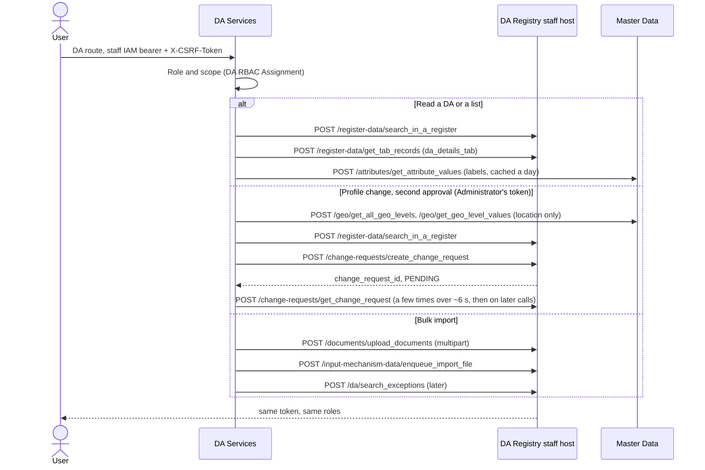

# DA Registry integration

DA Services does not own the DA register. A DA's own profile, the agent lists, profile changes and the bulk import go through the DA Registry staff host. Unlike Farmer and Crop Sown, the DA Registry is called **with the signed-in user's own staff IAM token**: DA Services checks its RBAC first, then forwards the user's bearer and CSRF value. The registry's own roles and audit apply to the real user.

Code: `da_services/integrations/da_registry/` (`client.py` interface, `mock.py`, `http.py`, `mapper.py` for every registry field name). Config: the `da_registry_*` keys, documented in `config.example.json`. The envelope sender is `da-services`.

## Identity

Where the registry is, and which register holds the DAs, is read from **DA Services Settings**: "DA Registry Domain" (a host name or a full URL), "DA Registry Form Register ID", and "DA Registry Tab ID" (the `tab_id` of `register-data/get_tab_records`: `da_details_tab`). All three are required: while one is empty every DA Registry call fails and names what to set ("DA Services Settings: set DA Registry Tab ID"). They are not read from `site_config.json`.

`da_registry_auth` selects whose token reaches the registry.

- `"user"` (the agreed mode): `Authorization: Bearer …` and `X-CSRF-Token` (header or cookie) are read once per request and sent on as header plus cookie with the same value (the IAM's double-submit pair). A DA Services-issued JWT (`iss` = `jwt_issuer`) or a missing token is refused with 401 before any registry call. A registry 401 or 403 is answered with that status and the registry's message; `GET /me` still returns roles, scope and menu with `agent_error`. DA Services does not refresh the IAM token (5 minutes on dev); the frontend signs the user in again.
- `"service"`: the `da-services-backend` client credentials (or, on dev only, a staff user's portal login). The token is cached per worker; every call gets a fresh random CSRF pair.

A scheduled job has no signed-in user. In user mode the 15-minute read-back of change requests is skipped (the DA's, Supervisor's or Administrator's own calls read the answer back instead), and the area sync always uses the service identity (`get_client(auth_mode="service")`). The service-account path stays in the code, unused for profile changes, for a later security phase.

## Flow

## DA routes

Prefix: `/api/v1/da-services`

| Route | Staff call |
| --- | --- |
| `GET /me` | The DA's record: search by DA-ID (exact match on top of the partial search), then the `da_details_tab` records |
| `GET /profile/my_profile` | The signed-in DA's own record, read directly by the registry's record id (`User.da_registry_id`, the `da_id` claim of IAM): one `get_tab_records`, no search. That is the only registry call of this route: the record comes with its education records and family members, the photo's link is on the record, the person the DA reports to is their DA-ID only, and no document link is asked for (`GET /profile/documents/{document_id}` gives one when the DA opens a certificate). A DA-ID in that field (`DA-…`) is searched first, as for `GET /me`. 404 when the User has no id or the registry does not know it. The answer is `profile`, `pending_requests` and `validation`; what a DA may ask to change is not part of it |
| `GET /profile/agents/{da_id}` (Supervisor, Administrator) | The DA's record, plus the read-back |
| `GET /profile/agents/{da_id}` (Supervisor, Executive, Administrator in scope) | Reads only: the DA's record and the Master Data code lists |
| `GET /profile/documents/{document_id}?da_id=` (a DA: own, without `da_id`) | Reads only: `documents/get_documents` for a short-lived link. Only a document on that DA's record (the photo, a certificate) opens |
| `GET /profile/certificates?da_id=` | DA Services only: each certificate's title, issuer and dates with `status` (`Pending verification`, `Verified`, `Rejected`); the registry keeps the file and its name only |
| `GET /profile/editable-fields?da_id=` (none: own record) | Reads only: the record and the Master Data code lists of the fields that may be asked for. Own record: the organisation's fields (`region`, `zone`, `woreda`, `kebele`, `position`, `specialisation`, `joined_date`, `reports_to`) are `locked_fields`; with `da_id`, a Supervisor above that DA may ask for every field |
| `POST /profile/change-requests` `{section, values, reason, client_op_id, da_id}` | Reads only: the DA's record, Master Data code lists, the geo chain for a location change. A `DA Profile Change Request` row in DA Services. Without `da_id` it is about the caller's own record; with it, a Supervisor asks for a DA below them. `section` `Contact`, `Qualifications`, `Identity` or `Location`; `values` `{field: new value}` |
| … `{section: "Education records", action: add/update/delete, record_id, values}` | Reads only. `values`: `education_level` (a `DA_EDUCATION_LEVEL` code or label) and `passout_year` (EC year, 1950 to now), both needed to add; nothing else (position, specialisation and joining date are Position and reporting fields) |
| … `{section: "Family members", action, record_id, values}` | As above. `values`: `name`, `relationship` (`DA_RELATIONSHIP`), `date_of_birth` |
| … multipart `section=Certificates`, `action=add`, `file`, `record_id`, `values` (`title`, `issuer`, `issued_on`, `expires_on`), `replaces`; or `action=delete`, `record_id`, `document_id` | Reads only. The file is kept in DA Services, private, on the request. PDF, JPG, PNG or WebP, up to 2 MB, at most 3 on a record; `replaces` is the `document_id` it takes the place of |
| … multipart `section=Photo`, `action=add`, `file`; or `action=delete` | Reads only. JPG, PNG or WebP, up to 2 MB (as the registry portal allows) |
| `GET /profile/change-requests?status=a,b&woreda=a,b&section=` | DA Services only. Approvals screen: Supervisor `Pending Supervisor`; Administrator `Pending Administrator,Registry failed`. Rows carry `da_name` (the registry's name when the request was sent) and `allowed_actions` |
| `GET /profile/change-requests/{id}` | DA Services only, with `history`; reads back a change that waits for the registry |
| `GET /profile/change-requests/{id}/file` | DA Services only: the file a `Certificates` or `Photo` request carries, to look at before deciding |
| `GET /profile/change-logs` `?da_id=&section=&limit=&start=` | DA Services only: the log of profile changes, one line per step of each request the caller may see, newest first (`request, da_id, da_name, section, changes, state, state_label, action, by, by_name, at, note`). `limit` / `start` page over requests; `meta.total` counts requests |
| `POST /profile/change-requests/action` `{request_id, action, note}` | The step named, one of the request's `allowed_actions`. `Approve` at level 1, `Reject`, `Request Changes`, `Cancel`, `Close`: DA Services only |
| … `Approve` at level 2 (Administrator) | `create_change_request` on one section, with the Administrator's token, then `get_change_request`. For a list or file section first `documents/upload_documents` for the request's file (once; a retry reuses the id), then the list section (`edit_action` ADD / UPDATE / DELETE; a record's `certificates` as its whole list) or, for the photo, `record_image_document_id` on the identity section. `documents/delete_documents` is never called |
| … `Retry` (Administrator) | Reads the DA's record first: if it already holds the requested values (the earlier answer was lost), the request is marked Applied and nothing is created. Otherwise `create_change_request` again, with the Administrator's token |
| … `Sync Local` (Administrator) | DA Services only: repeats the move of the DA's DA RBAC grant after an applied location change (`local_sync_state = Failed`) |
| … `{request_ids: [...], action, note}` (at most 20) | The same step on each request; one that cannot take it is reported, the rest go on. The registry's answer is read once, not waited for |

What the portal gets with these answers, so it repeats none of the rules:

- **The DA record's lists** (DA Registry #66): `profile.photo` (a link that lives
  about an hour; made from the photo's document when the record carries no link),
  `profile.qualifications[]` (`id`, `education_level` and `_label`, `passout_year`,
  `certificates[] {document_id, name}`, `is_main`; the main record first: the latest passout year,
  which the registry copies onto the DA record as `profile.education_tier` and `profile.passout_year`) and `profile.family_members[]` (`id`, `name`, `relationship` and
  `_label`, `date_of_birth`; also under its earlier name `profile.dependents[]`). A certificate opens through `GET /profile/documents/{document_id}`;
  `GET /profile/my_profile` adds `validation {record_found, record_status, is_active}` and the profile carries
  `internal_record_id`, `record_status`, `last_approved_at`, `last_approved_by` and `source` of the record.
  They change through the list and file requests in the table above, approved like every other
  profile change. `profile.home_address` (the registry's `address_line_1`, where the DA lives) is one
  line of up to 100 characters and changes with the Contact section (`home_address`).

- **`fields`** (both profile calls): per field `section`, `kind`, `note_required`, `profile_key` (the
  key of the same value in `profile`), `current` (the DA's value as a change would send it: the code of
  a coded field) and `current_label`. A coded field has `options` `[{code, label}]` from its Master Data
  list; `options` is `null` when the list cannot be read at that moment (the value is still checked when
  the request is sent).
- **Every change request**: `allowed_actions`, the steps this caller may take now (what the Frappe
  Workflow gives them, plus `Sync Local`), to send to `POST /profile/change-requests/action`;
  `requested_by_name`, `l1_by_name`, `l2_by_name`, `closed_by_name`;
  `region_name`, `zone_name`, `woreda_name` as the registry gave them when the request was sent (empty
  on older rows). `changes` is `{field: {from, to}}`, with `from_label` and `to_label` for coded and
  location fields. Date-times are ISO 8601 in the site's time zone, without an offset.
- **`GET /profile/change-requests?mine=1`**: the requests the caller sent. A Supervisor's own requests
  wait for an Administrator, so they are in no queue of the Supervisor's.
- **`GET /profile/change-requests?no_supervisor_found=1`**: the requests still at `Pending Supervisor`
  in a Woreda that had no Supervisor when they were sent. They are in no queue; the Administrator's
  screen lists them as a warning, and the remedy is to assign a Supervisor.
- **`history`** (`GET /profile/change-requests/{id}`): the steps of the request, oldest first, each
  `{state, action, by, by_name, at, note}` (the state the step led to, the step, and its note); the DA Registry's answer has `by_name` "DA Registry" and no `by`.
- **Lengths**: `reason` and `note` hold 500 characters at most.
- **Files**: a certificate or photo request records the fingerprint (`sha256`, in `changes`) of the file it was sent with. That file is what `GET …/file` shows an approver and what is uploaded to the registry; another file attached to the request later is ignored, and a request whose file no longer matches cannot be shown or sent (the DA sends a new request). Open requests from before fingerprints are given theirs on migrate.
- **A request that never got the registry's answer**: the approval is saved before the registry is called. If the call's process dies, the request stays at `Sent to registry` with no change request id; after five minutes it becomes `Registry failed` (the scheduled job, or the next read of it), and Retry first looks whether the registry already holds the values.
- **Bulk results** (`request_ids`): `results[]` with `name`, `ok`, `status`, `status_label`, `code` and
  `message` per request, and `done` / `failed` counts.
- **Error codes** (all HTTP 400): `ALREADY_DECIDED` (the request left the state the action needs:
  reload it), `OPEN_REQUEST_EXISTS`, `NOTHING_TO_CHANGE`, and `VALIDATION_ERROR`, with
  `details {field: message}` when one field's value is not acceptable.
| `GET /agents`, `GET /agents/{da_id}`, `GET /experts`, `GET /assignments` | Search filtered by `woreda_code` / `region_code`, then one `get_tab_records` per DA (8 workers, records cached 5 minutes; a single DA is always read live) |
| `GET /agent-imports/template`, `POST /agent-imports/validate` | DA Services only |
| `POST /agent-imports` | `upload_documents`, then `enqueue_import_file` |
| `GET /agent-imports` | DA Services only (`DA Integration Event`, type `Agent Import`) |
| `GET /agent-imports/exceptions` | `search_exceptions` |

Scope is checked against the registry's own Region / Zone / Woreda codes on the record, never against anything the caller sent. The DA-ID of a Development Agent comes from their DA RBAC Assignment only.

## Profile changes

Nobody edits the register from DA Services directly. Decided 12 Nov 2026: a change to an existing DA is approved in DA Services at two levels; the registry no longer runs its own approval for change requests (registry branch `feat/change-request-no-registry-approval`, not yet on Dev). Registering a new DA is unchanged.

The steps, and who may take each, are the Frappe Workflow "DA Profile Change Request" (states = the `status` values below). DA Services creates it on a site that has none (`da_services/workflows/profile_change.py`, on install and migrate) and never overwrites one that exists, so an administrator can change roles and conditions, or add an approval level, in the Desk. `status` is a Link to Workflow State, so a new state needs no schema change.

**Changing the levels in the Desk** needs no code and no deploy. The app does not name a level; it reads the Workflow:

- Sent to registry, Applied and Registry failed are the system's states and keep their names. No step leads to Applied or Registry failed: the app writes them after the registry answers.
- Cancel and Submit for DA are the requester's own steps.
- Every other transition out of a state that is not the system's is a decision. A request waits in a state that a decision leaves. The decision that leads to Sent to registry is the last approval: whoever gives it sends the change with their own token, so they need write access in the DA Registry.

To add a level (for example Supervisor, then Executive, then Administrator):

1. Workflow State: create the state, for example "Pending Executive".
2. Workflow "DA Profile Change Request": add the state row; point the transitions that led from the level before it to the level after it at the new state; add the new state's own transitions (Approve to the next state, Reject to Rejected, Cancel to Cancelled with role All and the requester condition). **Untick "Allow Self Approval" on Approve and Reject** (the Desk ticks it on a new row); leave it ticked on Cancel.
3. Role Permission Manager: give the level's role `write` on DA Profile Change Request (taking a step is a save).
4. Place the level's people in DA Hierarchy above the DAs they decide for. A person who can also send requests (any role with `create`, which includes Development Agent, a role staff accounts usually hold besides their own) sees and decides only their own requests and those of people below them; a person whose only role on this DocType reads without `create` sees requests by geography instead. Copy the condition of the Supervisor's Approve onto the level's transitions when only people above the DA may decide there; without it, anyone with the role who sees the request may.

To have one level only, remove the other state's row and its transitions; the first state row is where every request starts. For the Supervisor alone, point their Approve at Sent to registry.

The Workflow is checked when it is saved, and the save is refused with what to change when: a decision has "Allow Self Approval" ticked, or a requester's step has it unticked; a step leads to Applied or Registry failed, or leaves Sent to registry or Applied; a system state is missing or is the first state; no decision leads to Sent to registry; Submit for DA leads anywhere but to a state where the request waits for a decision.

Right before anything is sent to the registry the app checks once more, on the request itself, that it carries an approval by someone other than its sender; without one nothing is sent, whatever the Workflow let through. A request is created only by the service (an insert from a form or an API call is refused), and what the service records on it (`decisions`, `l1_*`, `l2_*`, `approver`) cannot be changed by a save. A step's own save changes the state and nothing else, so a Workflow state row may not set a field (Update Field) and a transition may not run tasks (Transition Tasks); the save of such a Workflow is refused.

What the app holds for every shape, whatever the rows say: nobody decides a request they sent; one person decides a request at one level only (a request sent back to a level can be decided there again by the same person); only the requester cancels; a request sent for someone else never goes from its sender straight to the registry. A request waiting at any level is "open" (its fields cannot be asked again), the people who can decide there are told (at most 100, one by one), the DA is told where it waits, and `no_supervisor_found` is set while nobody can decide it there. `l1_*` and `l2_*` are the fields of the two original levels; every step of every level, with its note, is in `decisions` on the request and in `history`.

A step is taken through `POST /profile/change-requests/action` or with the Workflow buttons of the Desk (the form's Actions menu and the list view's bulk action), never by saving the document. Both run the same service: a step also records who decided, tells the people concerned and, at the last approval, sends the change to the registry. `hooks.py` routes Frappe's `apply_workflow` and `bulk_workflow_approval` to `workflows/desk.py` for this DocType (`override_whitelisted_methods`); every other DocType keeps Frappe's own. A note for a Desk step (needed to reject, ask for changes or close) is written in the form's "Note for the next step" and saved before the action is chosen; it is the only field a save may change on a sent request, and it is cleared once the step is taken. The note counts only when the person taking the step was the last to save the request (someone else's note is never recorded as theirs). The list view's bulk action carries no note and takes at most 20 requests at a time, so a step that needs a note is taken on the form. "Send Email Alert" must stay off on this Workflow (refused at save): Frappe's emailed links would take the step outside the service. Where the registry takes each person's own staff IAM sign-in (`da_registry_auth` = `user`), a Desk session has none: a step that sends to the registry (the last approval, `Retry`) is refused there before anything changes, with a message to take it in the portal; every other step works in the Desk. With the service identity (`service`) every step works in the Desk. While a site has no active Workflow, requests can be read and sent but no step can be taken.

**Logs.** Each step is kept in three places: the request's `Steps` (`decisions`: state reached, action, who, when, note), which `history` and `GET /profile/change-logs` read; an Info comment on the request's timeline in the Desk with the step and its note, next to Frappe's own Workflow line; and a DA Audit Log entry (`profile_change_*`) for every step and every registry call.

Who sees a request (`query_conditions` and `has_permission` in the same module, hooked in `hooks.py`): the person it is about, the person who sent it, everyone who holds a User Permission on the DA's User (DA Hierarchy gives one on every User below a person), and those who give the last approval or handle registry failures. A request with no User (the DA has never signed in, or the row is from before requests named one) is seen by those who give level 1 and hold a User Permission on its Woreda. A role that only reads (no `create`) keeps the geography rules Frappe applies. This is stated in code because Frappe alone lets a row through when its Link is empty and lets a user with no User Permission see every row.

1. **Request.** A person asks for a change to their own record (no `da_id`), or a Supervisor asks for one on a DA below them in DA Hierarchy (`da_id`; for a DA who has never signed in, and so has no User, the DA's Woreda decides). One section per request, only the fields that change. On their own record nobody asks for the organisation's fields (posting, position, specialisation, joining date, reports to).
2. **Level 1.** A Supervisor above the DA in DA Hierarchy approves, rejects or asks for changes. Everyone above the DA with that role sees the request and is notified; the first decision wins (the row is locked while it is decided). A Supervisor's own request for a DA goes straight to level 2, with that Supervisor recorded as level 1.
3. **Level 2.** An OAN Administrator approves or rejects. Never the person who gave level 1, and nobody decides a request they sent.
4. **Registry.** On the level-2 approval, in the Administrator's request, DA Services creates one change request with the Administrator's token. No registry write is made in a DA's or a Supervisor's request (with the planned registry roles their tokens read only). The answer is read back (`approval_status` only; `awe_request_status_summary` is not reliable): a few times over `da_registry_cr_readback_seconds` (default 6), then on the DA's, Supervisor's or Administrator's next call. The approval and the registry's answer to the create are committed as soon as the create has been tried (the registry write cannot be rolled back), which also frees the row before the wait. A read-back commits what it records too (it mostly runs inside GET requests, whose writes Frappe discards) and takes the request's lock without waiting, so several calls reading the same answer at once record it, and notify the DA, once.

| Status | Meaning |
| --- | --- |
| `Pending Supervisor` | Waits for level 1 |
| `Pending Administrator` | Level 1 given, waits for level 2 |
| `Sent to registry` | Approved here, the registry answered PENDING (Dev until the registry change is deployed) |
| `Applied` | The registry says APPROVED: the register holds the new values |
| `Registry failed` | Approved here, but the registry refused it (`registry_sync_state = Refused`, with `registry_error_code` and `registry_error`), rejected it later, or was down (`Unavailable`). The Administrator retries or closes it |
| `Rejected`, `Changes requested`, `Cancelled`, `Closed` | Final |

A field can be in one open request at a time (`Pending …`, `Sent to registry`, `Registry failed`): a second request may change other fields of the same section (the mobile number while an email change waits), not the same field; the four location levels travel together. Closing a failed request frees its fields. The registry takes one pending change per DA and section: once its own approval is off that lasts seconds, and a second request it refuses meanwhile (`REQ-VAL-000`) goes to `Registry failed` for the Administrator to retry. Every step is in the audit log (`profile_change_requested`, `profile_change_level1_decided`, `profile_change_level2_decided`, `profile_change_registry_result`, `profile_change_retried`, `profile_change_closed`, `profile_change_cancelled`), and the DA is told what really happened. A request for a Woreda that has no Supervisor grant is flagged `no_supervisor_found` and logged; it still waits for a Supervisor.

### Fields (`services/profile_fields.py`)

| Section | Request fields | Registry fields | Checks in DA Services |
| --- | --- | --- | --- |
| Contact, `da_contact_section_04` | `mobile`, `telegram`, `alternate_mobile`, `email`, `home_address` | `mobile_number`, `telegram_number`, `alternate_number`, `email`, `address_line_1` | Ethiopian phone as the registry takes it, landlines too (`^(\+251\|0)?[1-9][0-9]{8}$`), email, address one line of 100 |
| Qualifications, `da_service_section_02` ("Position and reporting" in the registry) | `position`, `specialisation`, `joined_date`, `reports_to` | `position`, `specialisation`, `joined_date`, `reports_to` | Master Data lists `DA_POSITION`, `DA_SPECIALISATION`; date `YYYY-MM-DD`, not in the future. `specialisation` for `DEVELOPMENT_AGENT` and `SENIOR_DA` only. `reports_to`: a DA-ID (`DA-…`) of an active person, not the DA, posted in the DA's Woreda or Zone; asked by the DA's Supervisor only, never in a DA's own request; not for `ADMIN`. The education level is not here: the registry refuses `education_level` on this section and copies it from the main education record |
| Identity, `da_identity_section_01` | `prefix`, `first_name`, `father_name`, `grandfather_name`, `gender`, `marital_status`, `birth_month_ec`, `birth_year_ec` (the Fayda ID is not offered: it is corrected in the registry itself) | `prefix`, `first_name`, `middle_name`, `last_name`, `gender`, `marital_status`, `birth_month_ec`, `birth_year_ec` | Lists `PREFIX`, `GENDER`, `MARITAL_STATUS`; names Latin or Ethiopic letters, spaces, apostrophes and hyphens, 100 at most (the registry's rule); month 1-13. A change of a name or the Fayda ID needs a reason of at least 10 characters |
| Location, `da_location_section_03` | `region`, `zone`, `woreda`, `kebele` (Master Data codes, all four) | `geo_lowest_level_value_id`, `geo_code_hierarchy_json` | Each level a child of the one above in Master Data |

Anything else is refused before a row is stored. Coded values are stored and sent as codes. The registry still checks formats and codes; its refusal (HTTP 200, `response_status` ERROR) is logged with `response_error_code` and shown to the Administrator.

### Location changes

The chain is built from Master Data with the sender's token, never hard-coded: one entry per level from the country down (`level`, `level_id`, `level_mnemonic`, `level_value_id`, `level_value_mnemonic`) plus `lowest_level_value_id`; it is rebuilt when the change is sent. The registry derives the names and flat codes itself. Level 1 is given by the Supervisor of the DA's current Woreda; the new Woreda's Supervisors are notified once the registry has applied the change. Then DA Services ends the DA's DA RBAC Assignment (kept as history) and starts a new one with the new Region / Zone / Woreda codes. Kebele Assignments are not changed: the Administrator who approved is notified to review them. The move of the grant is all or nothing; if it fails the request stays `Applied` with `local_sync_state = Failed` and `local_sync_error`, the Administrator is told, and `…/sync-local` repeats it. Until the registry re-derives the flat columns on Dev, the profile reads the location from `geo_code_hierarchy_json` first.

## Bulk import

An OAN Administrator uploads a CSV or XLSX in the registry's DA import template v3 (21 columns). DA Services checks the columns and every row first (required fields, 16-digit Fayda ID, duplicates, phone, email, EC birth month and year, joining date; row numbers follow the file). A clean file is uploaded and queued with the admin's token; the registry processes it in the background, each valid row becoming a submission on its two-stage approval. Rows it refuses appear in `GET /agent-imports/exceptions`.

## Codes and labels

Region / Zone / Woreda / Kebele are Master Data P-codes (`ET04`, `ET0403`, `ET040301`, `ET04030101`). Coded fields (prefix, gender, marital status, education level, specialisation, position) are shown as Master Data labels, read once a day; without `da_registry_master_data_url` the codes are shown as words.

## Roles

| Who | DA Services role (from the IAM token: `oan-client` client roles plus the login option's default) | DA RBAC Assignment | DA Registry (`da-registry-staff-portal`) |
| --- | --- | --- | --- |
| Development Agent | Development Agent (default) | role + own `da_id` + region / zone / woreda | Data Supervisor (read only; planned, Dev still Data Editor) |
| Supervisor / Executive | Supervisor / Executive | role + woreda or region / zone | Data Supervisor (read only; planned) |
| OAN Administrator | OAN Administrator | role, no scope | Data Editor (the only token that creates a change request), Intake Officer (import), Integration Manager (exceptions) |

Roles added by hand in DA Services are reset at the user's next IAM sign-in; they must come from Keycloak.

## Errors

| Registry answer | DA Services |
| --- | --- |
| timeout, connection error, 5xx | 503, retry later |
| 4xx, including non-JSON (gateway 413, HTML 404) | the same class of error, not retried |
| 401 / 403 on the user's token | 401 / 403 with the registry's message |
| record not found | 404 |

## Testing

`postman/DA-Registry/` holds the collection and environment: folder 0 signs in through Keycloak and the staff IAM and saves `access_token` and `csrf_token`; folders 1 to 3 cover the DA, officer and administrator calls, every request with both headers. Unit tests stub `requests.post` with a fake registry shaped like the real envelopes (`tests/test_da_registry_http.py`); the mock backend (`da_registry_backend: "mock"`, the default) serves fixtures for every other test.
