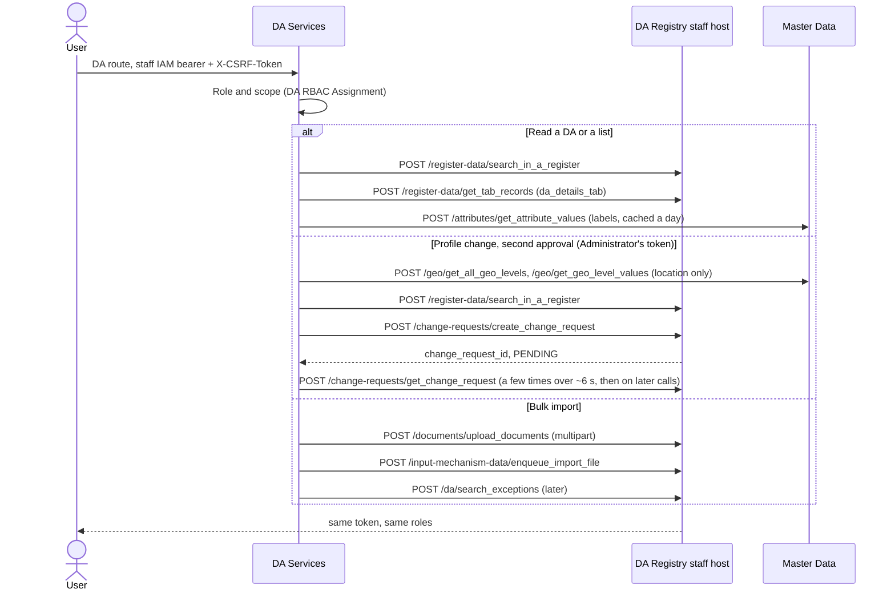

# DA Registry integration

DA Services does not own the DA register. A DA's own profile, the agent lists, profile changes and the bulk import go through the DA Registry staff host. Unlike Farmer and Crop Sown, the DA Registry is called **with the signed-in user's own staff IAM token**: DA Services checks its RBAC first, then forwards the user's bearer and CSRF value. The registry's own roles and audit apply to the real user.

Code: `da_services/integrations/da_registry/` (`client.py` interface, `mock.py`, `http.py`, `mapper.py` for every registry field name). Config: the `da_registry_*` keys, documented in `config.example.json`. The envelope sender is `da-services`.

## Identity

`da_registry_auth` selects whose token reaches the registry.

- `"user"` (the agreed mode): `Authorization: Bearer …` and `X-CSRF-Token` (header or cookie) are read once per request and sent on as header plus cookie with the same value (the IAM's double-submit pair). A DA Services-issued JWT (`iss` = `jwt_issuer`) or a missing token is refused with 401 before any registry call. A registry 401 or 403 is answered with that status and the registry's message; `GET /me` still returns roles, scope and menu with `agent_error`. DA Services does not refresh the IAM token (5 minutes on dev); the frontend signs the user in again.
- `"service"`: the `da-services-backend` client credentials (or, on dev only, a staff user's portal login). The token is cached per worker; every call gets a fresh random CSRF pair.

A scheduled job has no signed-in user. In user mode the 15-minute read-back of change requests is skipped (the DA's, Supervisor's or Administrator's own calls read the answer back instead), and the area sync always uses the service identity (`get_client(auth_mode="service")`). The service-account path stays in the code, unused for profile changes, for a later security phase.

## Flow

## DA routes

Prefix: `/api/v1/da-services`

| Route | Staff call |
| --- | --- |
| `GET /me` | The DA's record: search by DA-ID (exact match on top of the partial search), then the `da_details_tab` records |
| `GET /profile/me` | Same, plus the read-back of changes sent to the registry |
| `GET /profile/agents/{da_id}` (Supervisor, Administrator) | The DA's record, plus the read-back |
| `POST /profile/change-requests` | Reads only: the DA's record, Master Data code lists, the geo chain for a location change. A `DA Profile Change Request` row in DA Services |
| `GET …`, `GET …/{id}`, `POST …/{id}/cancel` | DA Services only; `GET …/{id}` reads back a change that waits for the registry |
| `POST /profile/change-requests/{id}/decide`, level 1 (Supervisor) | DA Services only |
| `POST /profile/change-requests/{id}/decide`, level 2 `Approve` (Administrator) | `create_change_request` on one section, with the Administrator's token, then `get_change_request` |
| `GET /profile/change-requests?status=a,b&woreda=a,b&section=` | DA Services only. Approvals screen: Supervisor `Pending Supervisor`; Administrator `Pending Administrator,Registry failed`. Rows carry `da_name` (the registry's name when the request was sent) |
| `POST /profile/change-requests/bulk-decide` `{ids, decision, note}` (at most 20) | As `decide` for each request; one that cannot be decided is reported, the rest go on. The registry's answer is read once, not waited for |
| `POST /profile/change-requests/{id}/retry` (Administrator) | Reads the DA's record first: if it already holds the requested values (the earlier answer was lost), the request is marked Applied and nothing is created. Otherwise `create_change_request` again, with the Administrator's token |
| `POST /profile/change-requests/{id}/sync-local` (Administrator) | DA Services only: repeats the move of the DA's DA RBAC grant after an applied location change (`local_sync_state = Failed`) |
| `POST /profile/change-requests/{id}/close` (Administrator) | DA Services only |
| `GET /profile/me`, `GET /profile/agents/{da_id}` (Supervisor, Executive, Administrator in scope) | Reads only: the DA's record and the Master Data code lists |

What the portal gets with these answers, so it repeats none of the rules:

- **`fields`** (both profile calls): per field `section`, `kind`, `note_required`, `profile_key` (the
  key of the same value in `profile`), `current` (the DA's value as a change would send it: the code of
  a coded field) and `current_label`. A coded field has `options` `[{code, label}]` from its Master Data
  list; `options` is `null` when the list cannot be read at that moment (the value is still checked when
  the request is sent).
- **Every change request**: `can_decide`, `allowed_decisions`, `can_cancel`, `can_retry`, `can_close`,
  `can_sync_local` for the caller; `requested_by_name`, `l1_by_name`, `l2_by_name`, `closed_by_name`;
  `region_name`, `zone_name`, `woreda_name` as the registry gave them when the request was sent (empty
  on older rows). `changes` is `{field: {from, to}}`, with `from_label` and `to_label` for coded and
  location fields. Date-times are ISO 8601 in the site's time zone, without an offset.
- **`GET /profile/change-requests?mine=1`**: the requests the caller sent. A Supervisor's own requests
  wait for an Administrator, so they are in no queue of the Supervisor's.
- **`GET /profile/change-requests?no_supervisor_found=1`**: the requests still at `Pending Supervisor`
  in a Woreda that had no Supervisor when they were sent. They are in no queue; the Administrator's
  screen lists them as a warning, and the remedy is to assign a Supervisor.
- **Bulk results**: each item has `ok`, `status`, `status_label`, `code` and `message`.
- **Error codes** (all HTTP 400): `ALREADY_DECIDED` (the request left the state the action needs:
  reload it), `OPEN_REQUEST_EXISTS`, `NOTHING_TO_CHANGE`, and `VALIDATION_ERROR`, with
  `details {field: message}` when one field's value is not acceptable.
| `GET /agents`, `GET /agents/{da_id}`, `GET /experts`, `GET /assignments` | Search filtered by `woreda_code` / `region_code`, then one `get_tab_records` per DA (8 workers, records cached 5 minutes; a single DA is always read live) |
| `GET /agent-imports/template`, `POST /agent-imports/validate` | DA Services only |
| `POST /agent-imports` | `upload_documents`, then `enqueue_import_file` |
| `GET /agent-imports` | DA Services only (`DA Integration Event`, type `Agent Import`) |
| `GET /agent-imports/exceptions` | `search_exceptions` |

Scope is checked against the registry's own Region / Zone / Woreda codes on the record, never against anything the caller sent. The DA-ID of a Development Agent comes from their DA RBAC Assignment only.

## Profile changes

Nobody edits the register from DA Services directly. Decided 12 Nov 2026: a change to an existing DA is approved in DA Services at two levels; the registry no longer runs its own approval for change requests (registry branch `feat/change-request-no-registry-approval`, not yet on Dev). Registering a new DA is unchanged.

1. **Request.** The DA asks for a change to their own profile, or the Woreda Supervisor asks for one on a DA of their Woreda (`da_id`). One section per request, only the fields that change. An Administrator does not send requests.
2. **Level 1.** A Supervisor whose grant is on the DA's Woreda approves, rejects or asks for changes. Every Supervisor of that Woreda sees the request and is notified; the first decision wins (the row is locked while it is decided). A Supervisor's own request starts at level 2, with that Supervisor recorded as level 1.
3. **Level 2.** An OAN Administrator approves or rejects. Never the person who gave level 1, and nobody decides a request for their own DA record or one they sent.
4. **Registry.** On the level-2 approval, in the Administrator's request, DA Services creates one change request with the Administrator's token. No registry write is made in a DA's or a Supervisor's request (with the planned registry roles their tokens read only). The answer is read back (`approval_status` only; `awe_request_status_summary` is not reliable): a few times over `da_registry_cr_readback_seconds` (default 6), then on the DA's, Supervisor's or Administrator's next call. The approval and the registry's answer to the create are committed as soon as the create has been tried (the registry write cannot be rolled back), which also frees the row before the wait. A read-back commits what it records too (it mostly runs inside GET requests, whose writes Frappe discards) and takes the request's lock without waiting, so several calls reading the same answer at once record it, and notify the DA, once.

| Status | Meaning |
| --- | --- |
| `Pending Supervisor` | Waits for level 1 |
| `Pending Administrator` | Level 1 given, waits for level 2 |
| `Sent to registry` | Approved here, the registry answered PENDING (Dev until the registry change is deployed) |
| `Applied` | The registry says APPROVED: the register holds the new values |
| `Registry failed` | Approved here, but the registry refused it (`registry_sync_state = Refused`, with `registry_error_code` and `registry_error`), rejected it later, or was down (`Unavailable`). The Administrator retries or closes it |
| `Rejected`, `Changes requested`, `Cancelled`, `Closed` | Final |

A field can be in one open request at a time (`Pending …`, `Sent to registry`, `Registry failed`): a second request may change other fields of the same section (the mobile number while an email change waits), not the same field; the four location levels travel together. Closing a failed request frees its fields. The registry takes one pending change per DA and section: once its own approval is off that lasts seconds, and a second request it refuses meanwhile (`REQ-VAL-000`) goes to `Registry failed` for the Administrator to retry. Every step is in the audit log (`profile_change_requested`, `profile_change_level1_decided`, `profile_change_level2_decided`, `profile_change_registry_result`, `profile_change_retried`, `profile_change_closed`, `profile_change_cancelled`), and the DA is told what really happened. A request for a Woreda that has no Supervisor grant is flagged `no_supervisor_found` and logged; it still waits for a Supervisor.

### Fields (`services/profile_fields.py`)

| Section | Request fields | Registry fields | Checks in DA Services |
| --- | --- | --- | --- |
| Contact, `da_contact_section_04` | `mobile`, `telegram`, `alternate_mobile`, `email` | `mobile_number`, `telegram_number`, `alternate_number`, `email` | Ethiopian mobile (`0911234567`, `+251911234567`), email |
| Qualifications, `da_service_section_02` | `education_tier`, `specialisation`, `position`, `joined_date` | `education_level`, `specialisation`, `position`, `joined_date` | Master Data lists `DA_EDUCATION_LEVEL`, `DA_SPECIALISATION`, `DA_POSITION`; date `YYYY-MM-DD`, not in the future |
| Identity, `da_identity_section_01` | `prefix`, `first_name`, `father_name`, `grandfather_name`, `fayda_id`, `gender`, `marital_status`, `birth_month_ec`, `birth_year_ec` | `prefix`, `first_name`, `middle_name`, `last_name`, `foundational_id`, `gender`, `marital_status`, `birth_month_ec`, `birth_year_ec` | Lists `PREFIX`, `GENDER`, `MARITAL_STATUS`; Fayda ID 16 digits; names letters only; month 1-13. A change of a name or the Fayda ID needs a reason of at least 10 characters |
| Location, `da_location_section_03` | `region`, `zone`, `woreda`, `kebele` (Master Data codes, all four) | `geo_lowest_level_value_id`, `geo_code_hierarchy_json` | Each level a child of the one above in Master Data |

Anything else is refused before a row is stored. Coded values are stored and sent as codes. The registry still checks formats, codes and duplicate Fayda IDs; its refusal (HTTP 200, `response_status` ERROR) is logged with `response_error_code` and shown to the Administrator.

### Location changes

The chain is built from Master Data with the sender's token, never hard-coded: one entry per level from the country down (`level`, `level_id`, `level_mnemonic`, `level_value_id`, `level_value_mnemonic`) plus `lowest_level_value_id`; it is rebuilt when the change is sent. The registry derives the names and flat codes itself. Level 1 is given by the Supervisor of the DA's current Woreda; the new Woreda's Supervisors are notified once the registry has applied the change. Then DA Services ends the DA's DA RBAC Assignment (kept as history) and starts a new one with the new Region / Zone / Woreda codes. Kebele Assignments are not changed: the Administrator who approved is notified to review them. The move of the grant is all or nothing; if it fails the request stays `Applied` with `local_sync_state = Failed` and `local_sync_error`, the Administrator is told, and `…/sync-local` repeats it. Until the registry re-derives the flat columns on Dev, the profile reads the location from `geo_code_hierarchy_json` first.

## Bulk import

An OAN Administrator uploads a CSV or XLSX in the registry's DA import template v3 (21 columns). DA Services checks the columns and every row first (required fields, 16-digit Fayda ID, duplicates, phone, email, EC birth month and year, joining date; row numbers follow the file). A clean file is uploaded and queued with the admin's token; the registry processes it in the background, each valid row becoming a submission on its two-stage approval. Rows it refuses appear in `GET /agent-imports/exceptions`.

## Codes and labels

Region / Zone / Woreda / Kebele are Master Data P-codes (`ET04`, `ET0403`, `ET040301`, `ET04030101`); DA Services' own area master is synced from the same source (`docs/area-master-sync.md`). Coded fields (prefix, gender, marital status, education level, specialisation, position) are shown as Master Data labels, read once a day; without `da_registry_master_data_url` the codes are shown as words.

## Roles

| Who | DA Services role (from the IAM token: `oan-client` client roles plus the login option's default) | DA RBAC Assignment | DA Registry (`da-registry-staff-portal`) |
| --- | --- | --- | --- |
| Development Agent | Development Agent (default) | role + own `da_id` + region / zone / woreda | Data Supervisor (read only; planned, Dev still Data Editor) |
| Supervisor / Executive | Supervisor / Executive | role + woreda or region / zone | Data Supervisor (read only; planned) |
| OAN Administrator | OAN Administrator | role, no scope | Data Editor (the only token that creates a change request), Intake Officer (import), Integration Manager (exceptions) |

Roles added by hand in DA Services are reset at the user's next IAM sign-in; they must come from Keycloak.

## Errors

| Registry answer | DA Services |
| --- | --- |
| timeout, connection error, 5xx | 503, retry later |
| 4xx, including non-JSON (gateway 413, HTML 404) | the same class of error, not retried |
| 401 / 403 on the user's token | 401 / 403 with the registry's message |
| record not found | 404 |

## Testing

`postman/DA-Registry/` holds the collection and environment: folder 0 signs in through Keycloak and the staff IAM and saves `access_token` and `csrf_token`; folders 1 to 3 cover the DA, officer and administrator calls, every request with both headers. Unit tests stub `requests.post` with a fake registry shaped like the real envelopes (`tests/test_da_registry_http.py`); the mock backend (`da_registry_backend: "mock"`, the default) serves fixtures for every other test.
