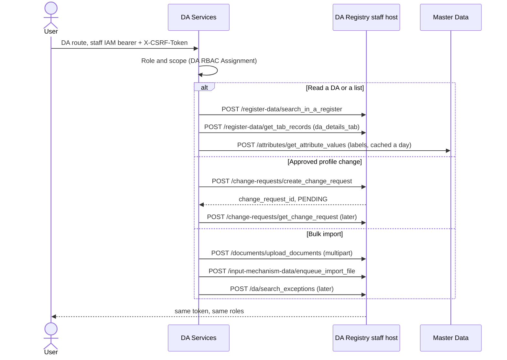

# DA Registry integration

DA Services does not own the DA register. A DA's own profile, the agent lists, profile changes and the bulk import go through the DA Registry staff host. Unlike Farmer and Crop Sown, the DA Registry is called **with the signed-in user's own staff IAM token**: DA Services checks its RBAC first, then forwards the user's bearer and CSRF value. The registry's own roles and audit apply to the real user.

Code: `da_services/integrations/da_registry/` (`client.py` interface, `mock.py`, `http.py`, `mapper.py` for every registry field name). Config: the `da_registry_*` keys, documented in `config.example.json`. The envelope sender is `da-services`.

## Identity

`da_registry_auth` selects whose token reaches the registry.

- `"user"` (the agreed mode): `Authorization: Bearer …` and `X-CSRF-Token` (header or cookie) are read once per request and sent on as header plus cookie with the same value (the IAM's double-submit pair). A DA Services-issued JWT (`iss` = `jwt_issuer`) or a missing token is refused with 401 before any registry call. A registry 401 or 403 is answered with that status and the registry's message; `GET /me` still returns roles, scope and menu with `agent_error`. DA Services does not refresh the IAM token (5 minutes on dev); the frontend signs the user in again.
- `"service"`: the `da-services-backend` client credentials (or, on dev only, a staff user's portal login). The token is cached per worker; every call gets a fresh random CSRF pair.

A scheduled job has no signed-in user. In user mode the 15-minute approval read-back is skipped (the DA's own calls read the decision back instead), and the area sync always uses the service identity (`get_client(auth_mode="service")`).

## Flow

## DA routes

Prefix: `/api/v1/da-services`

| Route | Staff call |
| --- | --- |
| `GET /me` | The DA's record: search by DA-ID (exact match on top of the partial search), then the `da_details_tab` records |
| `GET /profile/me` | Same, plus the read-back of pending change requests |
| `POST /profile/change-requests`, `GET …`, `GET …/{id}`, `POST …/{id}/cancel` | DA Services only (a `DA Profile Change Request` row) |
| `POST /profile/change-requests/{id}/decide` with `Approve` | `create_change_request` on `da_contact_section_04` or `da_service_section_02`, with the approver's token |
| `GET /agents`, `GET /agents/{da_id}`, `GET /experts`, `GET /assignments` | Search filtered by `woreda_code` / `region_code`, then one `get_tab_records` per DA (8 workers, records cached 5 minutes; a single DA is always read live) |
| `GET /agent-imports/template`, `POST /agent-imports/validate` | DA Services only |
| `POST /agent-imports` | `upload_documents`, then `enqueue_import_file` |
| `GET /agent-imports` | DA Services only (`DA Integration Event`, type `Agent Import`) |
| `GET /agent-imports/exceptions` | `search_exceptions` |

Scope is checked against the registry's own Region / Zone / Woreda codes on the record, never against anything the caller sent. The DA-ID of a Development Agent comes from their DA RBAC Assignment only.

## Profile changes

A DA never edits the register directly.

1. The DA submits one section per request (Contact or Qualifications). Identity fields are locked (Fayda), and only fields the registry holds are editable (`editable_fields`; the staff API has no language or photo).
2. The Woreda Supervisor approves, rejects or sends it back in DA Services.
3. On approval DA Services opens a registry change request with the approver's token. The registry's two-stage approval still applies; the profile keeps showing the registry's values until then. While the registry decides, the row is `Applied` with `registry_approval = Pending` and the DA cannot open a second request for that section (the registry takes one pending change per DA and section).
4. The decision is read back: every 15 minutes in service mode, or when the DA opens their profile or sends the next request in user mode. The DA is notified either way.

An answer without `change_request_id`, or a field the registry does not take, is a visible failure on the row (`registry_sync_state = Failed`), never a silent Pending.

## Bulk import

An OAN Administrator uploads a CSV or XLSX in the registry's DA import template v3 (21 columns). DA Services checks the columns and every row first (required fields, 16-digit Fayda ID, duplicates, phone, email, EC birth month and year, joining date; row numbers follow the file). A clean file is uploaded and queued with the admin's token; the registry processes it in the background, each valid row becoming a submission on its two-stage approval. Rows it refuses appear in `GET /agent-imports/exceptions`.

## Codes and labels

Region / Zone / Woreda / Kebele are Master Data P-codes (`ET04`, `ET0403`, `ET040301`, `ET04030101`); DA Services' own area master is synced from the same source (`docs/area-master-sync.md`). Coded fields (prefix, gender, marital status, education level, specialisation, position) are shown as Master Data labels, read once a day; without `da_registry_master_data_url` the codes are shown as words.

## Roles

| Who | DA Services role (from the IAM token: `oan-client` client roles plus the login option's default) | DA RBAC Assignment | DA Registry (`da-registry-staff-portal`) |
| --- | --- | --- | --- |
| Development Agent | Development Agent (default) | role + own `da_id` + region / zone / woreda | Data Editor |
| Supervisor / Executive | Supervisor / Executive | role + woreda or region / zone | Data Editor |
| OAN Administrator | OAN Administrator | role, no scope | Data Editor, Intake Officer (import), Integration Manager (exceptions) |

Roles added by hand in DA Services are reset at the user's next IAM sign-in; they must come from Keycloak.

## Errors

| Registry answer | DA Services |
| --- | --- |
| timeout, connection error, 5xx | 503, retry later |
| 4xx, including non-JSON (gateway 413, HTML 404) | the same class of error, not retried |
| 401 / 403 on the user's token | 401 / 403 with the registry's message |
| record not found | 404 |

## Testing

`postman/DA-Registry/` holds the collection and environment: folder 0 signs in through Keycloak and the staff IAM and saves `access_token` and `csrf_token`; folders 1 to 3 cover the DA, officer and administrator calls, every request with both headers. Unit tests stub `requests.post` with a fake registry shaped like the real envelopes (`tests/test_da_registry_http.py`); the mock backend (`da_registry_backend: "mock"`, the default) serves fixtures for every other test.
