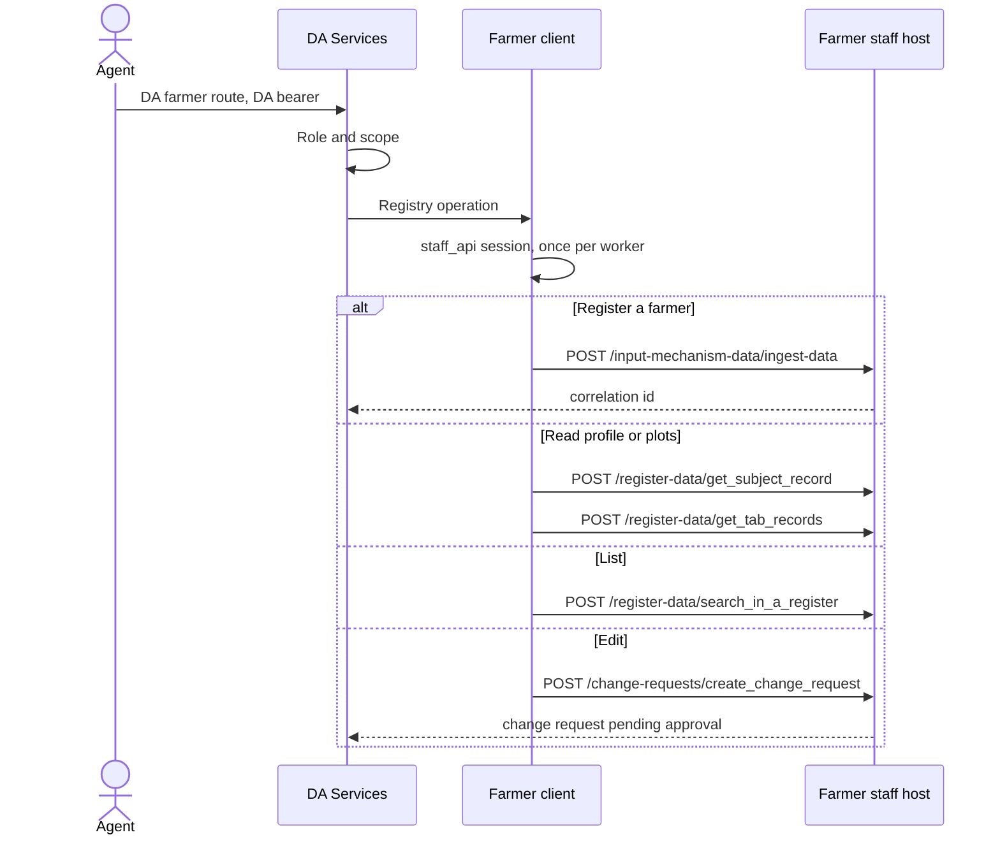

# Farmer integration

DA Services does not own the Farmer register. Profile, land, registration, and profile edits go through the Farmer staff host. The DA caller authenticates with DA Services. That bearer is not sent to staff. The farmer client adds the staff bearer and the matching CSRF cookie.

Code: `da_services/integrations/farmer_registry/http.py`. Config: `farmer_registry_url` and `farmer_registry_keycloak`. The envelope sender is `DA_SERVICES`. An empty filter is `""`. The envelope includes `instance_id`.

## Flow

Registration is asynchronous. The staff call returns a correlation id. Status is `POST /ingestion-data/search_in_ingestion_data`.

An edit is not a direct write. Each editable section becomes a change request. Fields the change-request route cannot take are rejected before the call.

## DA routes

Prefix: `/api/v1/da-services`

| Route | Staff call |
| --- | --- |
| `GET /farmers` | Search the register |
| `POST /farmers` | Ingest |
| `GET /farmers/{id}/profile` | Subject record |
| `GET /farmers/{id}/plots` | Land tab records |
| `PATCH /farmers/{id}` | Change request |
| `GET /farmers/{id}/update-status` | Change-request status stored by DA Services |
| `POST /farmers/updates/{event_id}/retry` | Retry a failed update event |

`GET /farmers/{id}/visits` and `GET /farmers/{id}/permissions` are DA Services data. They do not call the Farmer staff host.
