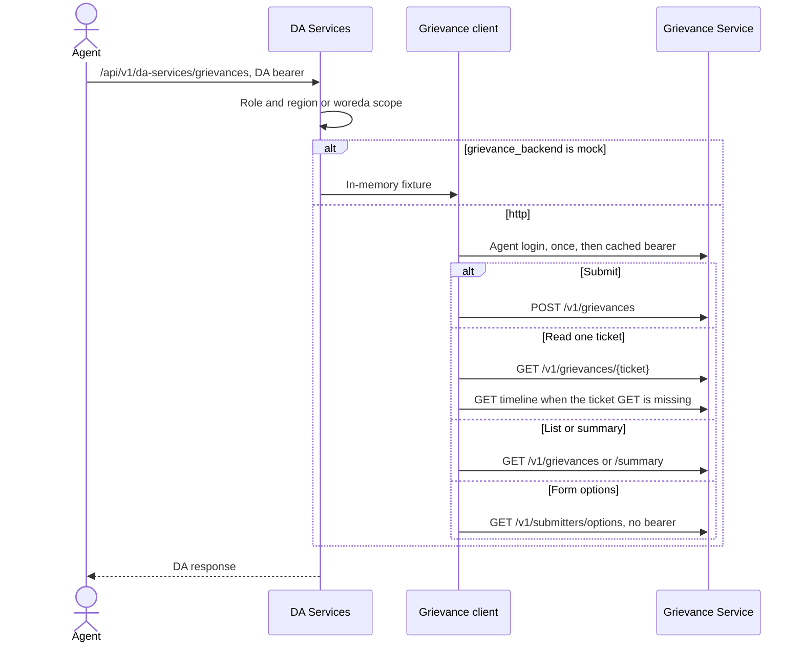

# Grievance integration

DA Services does not store grievance cases. The caller authenticates with DA Services. DA Services then calls the Grievance Service with a separate bearer. That token is not the DA token and not a Crop Sown staff token.

`grievance_backend` defaults to `mock`. Set it to `http` for the live service. The call table, login steps, and field mapping are in [grievance-da-http.md](grievance-da-http.md). This page is the path those calls take.

Officer actions (resolve, reopen, close, reassign) are not on the DA routes.

## Flow

A failed live submit can be queued as a DA Integration Event. `POST /grievances/sync/retry` retries that event. DA Services Admin only. A repeated `client_submission_uuid` returns the original ticket.
