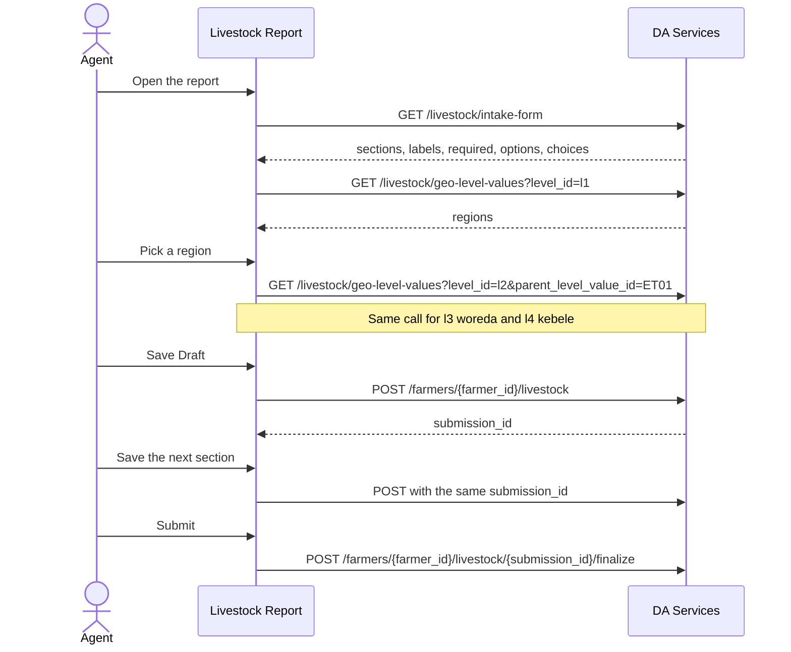

# Livestock API guide for the frontend

The Livestock Report page calls DA Services. It does not call the staff Livestock host or the master-data host. Use the same DA session already used for `GET /api/v1/da-services/me`.

Prefix every path below with `/api/v1/da-services`. Send `Authorization: Bearer <access_token>` and `Accept: application/json`. POST bodies are JSON. Livestock calls also send `X-CSRF-Token`. DA Services forwards that header to the staff host. A missing token or CSRF header is HTTP 401.

A success body is:

```json
{
  "status": "success",
  "message": "Success",
  "data": {},
  "meta": { "api_version": "v1" },
  "request_id": "..."
}
```

Show `message` from an error body. A field rejection names the field. A registry outage is HTTP 503 and `SERVICE_UNAVAILABLE`.

Read roles: Development Agent, Supervisor, Executive, Administrator. Write roles: Development Agent, Supervisor, Administrator. An Executive can open the form and cannot save.

## What the current page must stop using

`src/features/farmers/livestockReport.ts` still builds the form from `LIVESTOCK_REPORT_FORM`. That file says there is no Livestock API yet. The options in it (Cattle, Boran, Meher, Due, Bee colonies) are page data. They are not this API.

Draw every control from `GET /livestock/intake-form`. The columns, the stored code, and the choice rows are in [livestock-field-maps.md](livestock-field-maps.md). That file was taken from the live intake-form response on 2026-11-02.

These page sections are not sections of the Livestock intake form. Do not send them:

| Page section | Why it is not sent |
| --- | --- |
| Holding (`production_system`, `primary_species`, `total_heads`, `grazing_land_ha`, `housing`) | No widget on this form |
| Herd structure (`adult_males`, `adult_females`, `young_stock`, …) | No widget on this form |
| Feed, water, production, sales | No widget on this form |
| `report_year`, `report_season` | No widget on this form |
| Ear tag replacement (`old_ear_tag`, `new_ear_tag`, `date_retagging`) | Not on the form rendered on 2026-11-02 |

The profile keys `ear_tag`, `sex`, `dob`, and `secondary_id` are display names. The registry names are `ear_tag_id`, `gender`, `date_of_birth`, and `secondary_identifier`.

## Tabs

There is one intake form, `Livestock Intake`. The response groups its sections into `screen_tabs`.

| Screen tab | `screen_tabs` key | Sections |
| --- | --- | --- |
| Farmer lookup | the form tab (`livestock_intake_tab` on this response) | `livestock_farmer_lookup` |
| Farmer | `farmer` | Survey personnel, location |
| Livestock | `livestock` | Animal rows |
| Health & Vaccination | `health` | Health events, vaccinations |
| Breeding & Vital Events | `breeding` | Vital events, breeding |

The lookup section's mnemonic on this form is `livestock_farmer_lookup`, so the response does not put it inside the `farmer` tab. Render it with the farmer sections. Save it with `section_id` `livestock_farmer_lookup`.

`screen_section` is an alias the save also accepts: `survey-personnel`, `address` or `location`, `herd` or `livestock-details`, `disease` or `health-event`, `vaccination`, `vital-event`, `breeding` or `breeding-details`. Prefer `section_id` from the response. The lookup section has no alias.

## Sequence



Load the form once. Load one geography level when the user opens that dropdown. Do not preload every kebele.

Keep `submission_id` from the first successful save and send it on every later save for that draft. The first save omits it, or sends `null`. An empty string is treated as a new draft.

## How to draw one field

Each section in `data.sections` has `section_id`, `section_mnemonic`, `screen_section` when one exists, `is_list`, and `fields`.

| Response field | Use it for |
| --- | --- |
| `field_name` | The key in the save record. |
| `label` | The control label. |
| `data_type` | `string`, `number`, `integer`, `date`, `boolean`. |
| `required` | Show the control as required. This is the widget flag. |
| `readonly` | Display the value. Do not send it. `age` and the event-row `species` are read-only. |
| `pattern` | Present only when the widget has one. `farmer_id` is `FR-` plus 12 digits. `ear_tag_id` is `ET` plus 10 digits. `fayda_id` is 12 digits or 16 digits. |
| `options` | Static dropdown. Show `label`. Store `value`. Yes/No on this form is boolean `true` / `false`. |
| `attribute_id` | Catalog name, for example `LIVESTOCK_SPECIES`. Not the dropdown rows. |
| `choices` | Catalog dropdown. Show `value_display`. Store the field's `value_key`. |
| `value_key` | `value_id`, `value_code`, or `value_display`. This is the column the widget stores. If it is absent, the serving process has not loaded the current backend. Use the six fields in scenario 2, and do not guess the others. |
| `catalog_loaded` | `false` means the list was not loaded. Do not invent options. |
| `geo` | This control is geography. Its rows come from the geography route, not from `choices`. |
| `is_list` | `true` means `records` is a table. Each object in `records` is one row. |
| `rules` | Show or require a field when another field on the same row matches. |

## Scenarios

### 1. Open the form

`GET /livestock/intake-form`

There is no `form` query. This register has one intake form.

Build the tabs from `data.screen_tabs` and the controls from `data.sections`. The section ids and the choice rows are in [livestock-field-maps.md](livestock-field-maps.md).

### 2. Catalog dropdown

When `catalog_loaded` is true, the options are `choices`.

```json
"choices": [
  {
    "value_id": "LIVESTOCK_HEALTH_STATUS_HEALTHY",
    "value_code": "HEALTHY",
    "value_display": "Healthy"
  }
]
```

Store the property named by `value_key`. A display label is accepted only when it matches `value_display` on the loaded list. The API then stores `value_key`.

On the 2026-11-02 form:

| Field | `value_key` | Send |
| --- | --- | --- |
| `species`, `breed`, `vaccine_type` | `value_id` | `CATTLE`, `BREED_LOCAL`, `VACCINE_TYPE_ANTHRAX_CATTLE` |
| `gender` | `value_code` | `SEX_FEMALE` |
| `health_status` | `value_code` | `HEALTHY` |
| `vaccination_status` | `value_code` | `UP_TO_DATE` |

`FEMALE`, `HEALTHY` as a long `LIVESTOCK_HEALTH_STATUS_*` id, and `Due` are not the stored values. The animal save on 2026-11-02 was rejected with "Health status: choose one from the list (Deceased, Healthy, Quarantined, Sick)" when the long `value_id` was forwarded. The widget's stored column is `value_code`.

For event type, disease, cause of death, location, breeding method, and breeding outcome, `value_key` was not read from the staff widget on this snapshot. Use `value_key` on the field in the intake-form response. Do not assume it is `value_id`.

### 3. Static dropdown

When `options` is set, there is no catalog. On this form, `is_notifiable` and `pregnancy_confirmed` are Yes / No. Send boolean `true` or `false`. The API accepts the strings `Yes` and `No` and stores the boolean.

### 4. Geography

A field with `geo.endpoint` of `geo-level-values` is not filled by the intake-form call.

1. `GET /livestock/geo-level-values?level_id=l1` returns regions. On 2026-11-02 the first row was `ET01`, Tigray.
2. After the user picks a region, `GET /livestock/geo-level-values?level_id=l2&parent_level_value_id=ET01`.
3. Woreda is `l3` with the selected zone id. Kebele is `l4` with the selected woreda id.

Each row has `level_value_id` and `level_value_mnemonic`. Show the mnemonic. Store the id.

Send `geo_lowest_level_value_id` as the kebele id the user selected. The holding read for `FR-512145929324` stored `ET04010101` (Bengua 01, Oromia). That is that holding's kebele, not a default for a new draft.

`latitude` and `longitude` are writable on this form. They are written by the holding-location widget together with `geo_lowest_level_value_id`.

### 5. Save Draft

`POST /farmers/{farmer_id}/livestock`

The path id is the Farmer-ID, `FR-` plus 12 digits. The route fills `farmer_id` on the lookup section. A different `farmer_id` in the body is refused.

The first save creates the draft. Leave `submission_id` out.

```json
{
  "sections": [
    {
      "section_id": "livestock_farmer_lookup",
      "records": [{ "fayda_id": "824459234875" }]
    },
    {
      "section_id": "livestock_survey_personnel_section_02",
      "records": [
        { "surveyor_name": "Abebe Kebede", "surveyor_mobile_number": "0911223344" }
      ]
    },
    {
      "section_id": "livestock_livestock_location_section_03",
      "records": [{ "geo_lowest_level_value_id": "ET04010101" }]
    }
  ]
}
```

`fayda_id` on this form is the widget. It accepts 12 digits (FIN) or 16 digits (FAN). The holding list echoes `fayda_fin` and `fayda_fan_id`. Do not also send those names unless the intake form lists them. The 12-digit value above is the FIN on the holding that was read. It is not a verified Fayda identity.

A successful save returns `submission_id` and `subject_record_id`. Store both. Send `submission_id` with later sections. `subject_record_id` is optional; the API reads it from the draft when it is missing.

The same body can carry the animal table. The API saves the Livestock register sections before a child table. A vaccination, health, vital, or breeding section saved alone, before any Livestock row exists, fails with "save the main Livestock section before this section". That was the vaccination response on 2026-11-02.

For a list section, `records` holds one object per table row. A section with `is_list` false accepts one object.

Omit a blank optional field. Do not send `""`. A required field left out fails with `{field_name} is required`.

Animal row, using the stored columns from the 2026-11-02 form:

```json
{
  "submission_id": "<from the first save>",
  "sections": [
    {
      "section_id": "livestock_animal_details_section_01",
      "records": [
        {
          "ear_tag_id": "ET2149721223",
          "species": "CATTLE",
          "breed": "BREED_LOCAL",
          "gender": "SEX_FEMALE",
          "date_of_birth": "2021-05-14",
          "health_status": "HEALTHY",
          "vaccination_status": "UP_TO_DATE",
          "registration_date": "2026-11-02"
        }
      ]
    }
  ]
}
```

Do not send `age`. The form computes it from `date_of_birth`.

### 6. Open a saved farmer

`GET /farmers/{farmer_id}/livestock` returns `{ farmer_id, livestock }`.

Each item is either:

| `kind` | What to render |
| --- | --- |
| `submission` | A draft or a submission waiting for approval. `sections` holds the rows that were saved. Match `section_id` to the intake form. |
| `record` | One full section row. Match `register_id` to `section_register_id` on the intake form. Animal rows have `ear_tag_id`, `species`, `breed`, `gender`, `health_status`, and `vaccination_status` on the object itself. |

Do not read the animal from `display_fields`. That array is the search summary. The list for `FR-512145929324` on 2026-11-02 returned the full rows: holdings, animals, health events, vaccinations, vital events, and breeding rows.

`GET /farmers/{farmer_id}/livestock?submission_id={submission_id}` returns that one submission, including `sections`. The query must be a real id. An empty `submission_id` returns the list above.

Pair each stored code with `value_display` from the intake-form `choices` for the label on screen. `HEALTHY` is shown as Healthy. `CATTLE` is shown as Cattle.

### 7. Submit

Save any remaining sections first. Then:

`POST /farmers/{farmer_id}/livestock/{submission_id}/finalize`

The body can be `{}`. A successful finalize is `draft_status` `FINAL` and `approval_status` `PENDING`. This route is implemented. The 2026-11-02 collection run called it with an empty id, so the path was `//finalize` and the response was 404. A live finalize of a real draft was not called. Treat a failure message from that call as the source of truth.

## Values the page must not send

| Do not send | Reason |
| --- | --- |
| `age` on an animal or event row | Read-only. The form fills it from `date_of_birth`. |
| `species` on a health, vaccination, vital, or breeding row | Read-only. It is copied from the animal with the same `ear_tag_id`. |
| `created_at`, `record_status`, `internal_record_id`, `link_*`, `record_name` | Managed by the registry. |
| `LIVESTOCK_HEALTH_STATUS_HEALTHY` or `LIVESTOCK_VACCINATION_STATUS_UP_TO_DATE` | Those are `value_id`. These two widgets store `value_code`. |
| `FEMALE`, `Due`, `Cattle`, `Boran` | Not the stored codes. Use `choices`. |
| The holding, herd-structure, feed, water, and sales fields | Not on this form. |
| Staff bearer tokens | The browser never authenticates to staff. |

An unknown field name fails with `unknown Livestock field {name}`. A value outside `options` or `choices` fails with `{name} is not an allowed value`. A read-only value fails with `{name} is read-only`.

## When the lists are empty

`catalog_loaded: false` means the serving site has no `livestock_registry_master_data_url`. The geography route then fails because that URL is not configured. Do not fall back to the lists in `livestockReport.ts`. Show the error.
