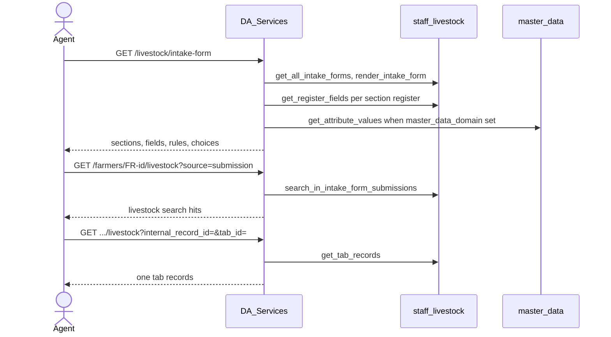

# Livestock integration

DA Services does not store Livestock records. The Livestock screen calls DA Services. DA Services checks the caller's role and the farmer's scope, then calls the Livestock staff host. Catalog rows and geography come from the master-data host.

Like Crop Sown, there is no ingest call. A draft is `save_intake_form_submission`, one section at a time, then `finalize_intake_form_submission` sends it for approval. GET reads follow the **Crop Sown call budget**: one staff search or one `get_tab_records` per user intent.

Shared transport: `da_services.integrations.staff_registry` (Settings config + FE CSRF forward).

## Hosts (DA Services Settings)

Desk **DA Services Settings** owns staff host and register id (same pattern as Crop Sown). Missing values fail closed (`StaffAPIError`).

| Settings field | Meaning |
| --- | --- |
| `livestock_registry_domain` | Livestock staff host (required) |
| `livestock_registry_form_register_id` | Livestock register UUID (required; no `get_all_registers`) |
| `master_data_domain` | Optional catalogs host; empty → `catalog_loaded: false` |

Staff calls forward the caller's `Authorization` and `X-CSRF-Token` as header **and** cookie. Missing either → 401. Do not self-generate CSRF on the request path.

## The form

The Livestock register's intake form is one staff form. The response also groups those sections into the screen tabs the Livestock Report uses (`screen_tabs`: Farmer, Livestock, Health & Vaccination, Breeding & Vital Events). `screen_section` on a section is the id the screen may send instead of `section_id`.

| Screen section id | Staff section |
| --- | --- |
| `identity` | `livestock_farmer_lookup` |
| `survey-personnel` | `livestock_survey_personnel_section_02` |
| `address`, `location` | `livestock_livestock_location_section_03` |
| `herd`, `livestock-details` | `livestock_animal_details_section_01` |
| `ear-tag-replacement` | `livestock_retagging_details_section_01` |
| `disease`, `health-event` | `livestock_health_event_details_section_01` |
| `vaccination` | `livestock_vaccination_details_section_01` |
| `vital-event` | `livestock_vital_event_details_section_01` |
| `breeding`, `breeding-details` | `livestock_breeding_details_section_01` |

The Submit Livestock Report sections Holding, Herd Structure, Feed, Water, Production and Sales are not sections of this registry. They are not accepted.

| # | Section id | Register | Kind |
| --- | --- | --- | --- |
| 1 | `livestock_farmer_lookup` | Livestock | one record: `farmer_id` (FR-…), `fayda_id` |
| 2 | `livestock_survey_personnel_section_02` | Livestock | one record: DA and supervisor name and mobile |
| 3 | `livestock_livestock_location_section_03` | Livestock | one record: place (`geo_lowest_level_value_id`), latitude, longitude |
| 4 | `livestock_animal_details_section_01` | Animal | table |
| 5–8 | health / vaccination / vital / breeding | child registers | tables linked by `link_internal_record_id` / `ear_tag_id` |

## Calls



## DA routes

Prefix: `/api/v1/da-services`

| Route | Staff call |
| --- | --- |
| `GET /livestock/intake-form` | Settings register id → intake forms → render → fields → catalogs |
| `GET /farmers/{id}/livestock?source=submission\|register` | **One** staff search (required `source`) |
| `GET /farmers/{id}/livestock?submission_id=` | `get_intake_form_submission` |
| `GET /farmers/{id}/livestock?internal_record_id=&tab_id=` | **One** `get_tab_records` (same as Crop) |
| `POST /farmers/{id}/livestock` | `save_intake_form_submission` per section |
| `POST /farmers/{id}/livestock/{submission_id}/finalize` | `finalize_intake_form_submission` |

Read: DA, Supervisor, Executive, Admin. Write: DA, Supervisor, Admin. `{id}` is the Farmer-ID, or an internal id that DA Farmer Reference maps to one. A Livestock record names its farmer by Farmer-ID, so an id without one is refused.

List returns search hits only (no N× submission hydrate, no `get_section_records` fan-out). Pair labels from `GET /livestock/intake-form`. A submission of another farmer is refused on read, save and finalize.

## What the intake form returns

The frontend renders the form from this payload and sends field names back as they are. The screen sequence and the field list are in [livestock-frontend.md](livestock-frontend.md) and [livestock-field-maps.md](livestock-field-maps.md).

Each section has `section_id`, `title`, `is_list`, `required_for_submit` and `fields` in screen order. A list section also has `table`; its `fields` are the table columns.

Each field has `field_name`, `widget`, `label`, `data_type`, `required` and `readonly`, and when the form sets them: `choices`, `options`, `rules`, `pattern`, `autofill`, `age_from`, `date_offset`, `writes`.

## Save

```json
{
  "submission_id": null,
  "sections": [
    {"section_id": "livestock_farmer_lookup", "records": [{"fayda_id": "824459234875"}]},
    {"section_id": "livestock_animal_details_section_01", "records": [
      {"ear_tag_id": "ET2149721223", "species": "CATTLE", "breed": "BREED_LOCAL", "gender": "FEMALE"}
    ]}
  ]
}
```

The response has `submission_id` and `subject_record_id`. Send `submission_id` with later sections.

## Verification note

Form and catalogs were read from development hosts on 2026-11-02. Save/finalize against live staff from DA Services may still need a partner run.
