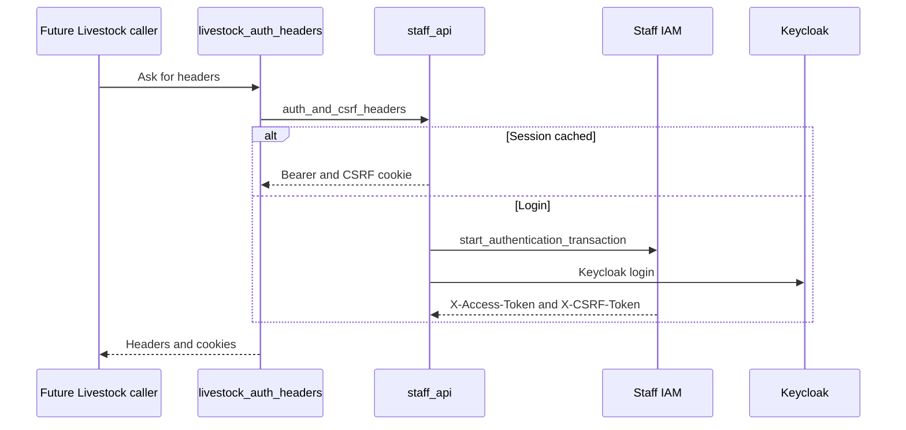

# Livestock integration

Livestock staff calls are not implemented. There is no DA Livestock route and no request to a Livestock host.

`da_services/integrations/livestock_registry/auth.py` only builds the staff session the other registries already use. `livestock_auth_headers` calls `auth_and_csrf_headers` with `livestock_registry_keycloak`, or the Farmer keycloak block when the Livestock block cannot log in. The portal client is `livestock-registry-staff-portal`.

The sequence stops when the headers exist. A Livestock register read, catalog, or save is not in this backend. The Crop Sown planning run fetched `LIVESTOCK_*` and `VACCINE_TYPE` only because that collection adds a fixed livestock set. Those lists are not part of the Crop Sown form and are not loaded for it.
