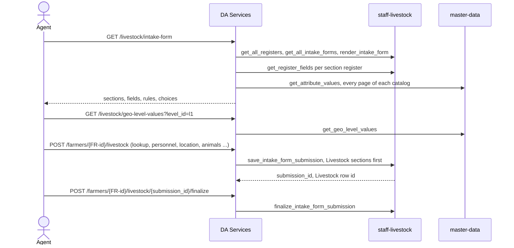

# Livestock integration

DA Services does not store Livestock records. The Livestock screen calls DA Services. DA Services checks the caller's role and the farmer's scope, then calls the Livestock staff host. Catalog rows and geography come from the master-data host.

Like Crop Sown, there is no ingest call. A draft is `save_intake_form_submission`, one section at a time, then `finalize_intake_form_submission` sends it for approval.

The form, fields and catalogs below were read from the development hosts on 2026-11-02.

## Hosts

| Config key | Development value |
| --- | --- |
| `livestock_registry_staff_url` | `https://staff-livestock.development.oanstaging.com` |
| `livestock_registry_master_data_url` | `https://master-data.development.oanstaging.com` |
| `livestock_registry_backend` | `http` on the site that serves the Livestock screen. `mock` is the local default. |

`config.example.json` lists every key. The register is found by `livestock_registry_register_mnemonic` (`Livestock`) and the form by `livestock_registry_form_name_contains` (`Livestock Intake`).

Staff calls forward the caller's `Authorization` and `X-CSRF-Token` headers, the same as Crop Sown and Farmer. A request without both is refused with 401 before anything is sent. `livestock_auth_headers` in `auth.py` still runs the staff IAM login for callers without a request.

## The form

The Livestock register has one intake form with one tab and eight sections.

| # | Section id | Register | Kind |
| --- | --- | --- | --- |
| 1 | `livestock_farmer_lookup` | Livestock | one record: `farmer_id` (FR-…), `fayda_id` |
| 2 | `livestock_survey_personnel_section_02` | Livestock | one record: DA and supervisor name and mobile |
| 3 | `livestock_livestock_location_section_03` | Livestock | one record: place (`geo_lowest_level_value_id`), latitude, longitude |
| 4 | `livestock_animal_details_section_01` | Animal | table: ear tag, species, breed, count, weight, birth date, sex, health and vaccination status |
| 5 | `livestock_health_event_details_section_01` | HealthEvent | table |
| 6 | `livestock_vaccination_details_section_01` | Vaccination | table |
| 7 | `livestock_vital_event_details_section_01` | VitalEvent | table |
| 8 | `livestock_breeding_details_section_01` | Breeding | table |

Sections 1 to 3 are one Livestock register row. Sections 4 to 8 are rows of their own registers, linked to it by `link_internal_record_id`. Event rows name the animal by `ear_tag_id`.

Twelve master-data catalogs feed the selects: `LIVESTOCK_SPECIES`, `LIVESTOCK_BREED`, `LIVESTOCK_HEALTH_STATUS`, `LIVESTOCK_VACCINATION_STATUS`, `LIVESTOCK_HEALTH_EVENT_TYPE`, `LIVESTOCK_DISEASE`, `LIVESTOCK_EVENT_LOCATION`, `VACCINE_TYPE`, `LIVESTOCK_VITAL_EVENT_TYPE`, `LIVESTOCK_CAUSE_OF_DEATH`, `LIVESTOCK_BREEDING_METHOD`, `LIVESTOCK_BREEDING_OUTCOME`.

## Calls



## DA routes

Prefix: `/api/v1/da-services`

| Route | Staff or master-data call |
| --- | --- |
| `GET /livestock/intake-form` | Discover the register and form, render it, `get_register_fields`, every catalog page |
| `GET /livestock/geo-level-values?level_id=&parent_level_value_id=` | `POST /geo/get_geo_level_values` |
| `GET /farmers/{id}/livestock` | `search_in_intake_form_submissions` and `search_in_a_register`, both by Farmer-ID |
| `GET /farmers/{id}/livestock?submission_id=` | `get_intake_form_submission` |
| `POST /farmers/{id}/livestock` | `save_intake_form_submission` per section |
| `POST /farmers/{id}/livestock/{submission_id}/finalize` | `finalize_intake_form_submission` |

Read: DA, Supervisor, Executive, Admin. Write: DA, Supervisor, Admin. `{id}` is the Farmer-ID, or an internal id that DA Farmer Reference maps to one. A Livestock record names its farmer by Farmer-ID, so an id without one is refused.

The list returns `kind: submission` for drafts and submissions waiting for approval (`record_name` is the Farmer-ID), and `kind: record` for approved register rows (`functional_record_id` LS-…, `farmer_id` in `display_fields`). A submission of another farmer is refused on read, save and finalize.

## What the intake form returns

The frontend renders the form from this payload and sends field names back as they are.

Each section has `section_id`, `title`, `is_list`, `required_for_submit` and `fields` in screen order. A list section also has `table` (label, add / edit / remove, dialog titles); its `fields` are the table columns.

Each field has `field_name`, `widget` (`text`, `number`, `date`, `select`, `radio`, `geo-hierarchy`, `oan-geo-point`), `label`, `data_type`, `required` and `readonly`, and when the form sets them:

| Key | Meaning |
| --- | --- |
| `choices` | Catalog rows `{value_id, value_display}`. Store `value_id`. `catalog_loaded: false` means the catalog was not read |
| `options` | Static `{label, value}` pairs (sex, yes / no) |
| `rules` | `show` and `require` actions, each with `condition {field, operator, value}`; operators `empty`, `notEmpty`, `equals`, `notEquals` on another field of the same row |
| `pattern`, `pattern_message`, `placeholder`, `min_date` | Input checks and hints |
| `autofill` | Event tables copy `species` and `age` from the animal row with the same `ear_tag_id` |
| `age_from` | `age` is shown from `date_of_birth` |
| `date_offset` | Next due date from the vaccine's interval |
| `writes` | Fields a geo widget fills, such as `{value: geo_lowest_level_value_id, hierarchy: geo_code_hierarchy_json}` |

## Save

```json
{
  "submission_id": null,
  "sections": [
    {"section_id": "livestock_farmer_lookup", "records": [{"fayda_id": "824459234875"}]},
    {"section_id": "livestock_survey_personnel_section_02", "records": [{"surveyor_name": "Abebe Kebede"}]},
    {"section_id": "livestock_livestock_location_section_03", "records": [{"geo_lowest_level_value_id": "ET01010101"}]},
    {"section_id": "livestock_animal_details_section_01", "records": [
      {"ear_tag_id": "ET2149721223", "species": "CATTLE", "breed": "BREED_LOCAL", "gender": "FEMALE",
       "health_status": "HEALTHY", "vaccination_status": "UP_TO_DATE", "registration_date": "2026-11-02"}
    ]}
  ]
}
```

The response has `submission_id` and `subject_record_id`. Send `submission_id` with later sections; `subject_record_id` is optional, it is read from the draft when missing.

Checks before each save, all from the live form:

- A field must have a widget in that section. Managed columns (`internal_record_id`, `link_*`, `record_*`, audit fields) are refused.
- `required` widgets and `require` rules are checked per row. The error names the section, row and field, for example `livestock_animal_details_section_01[1].species is required`.
- A select takes the code or its label; the code is stored. Dates take `YYYY-MM-DD` or `DD/MM/YYYY`. Numbers and booleans may be strings.
- Read-only fields are refused, except `age` (from the birth date) and the autofilled `species` and `age` of event rows.
- `farmer_id` is filled from the route. A different value is refused.
- Event rows get `species` and `age` from an animal row sent in the same request with the same ear tag.
- `geo_code_hierarchy_json` is built from the kebele id when it is not sent: ET01010101 gives ET01 › ET0101 › ET010101 › ET01010101 at levels l1 to l4.

The registry fills the place names and ids, `farmer_uuid`, `farmer_name` and `total_animals` itself.

## Verified

Read on the development hosts on 2026-11-02 through the client: the form (8 sections, 12 catalogs loaded), regions and zones, a farmer's five submissions and three approved records, and one submission with all eight sections. Save and finalize were not run against the development host from DA Services. A submission saved through the partner API that day has the same section and link layout.
