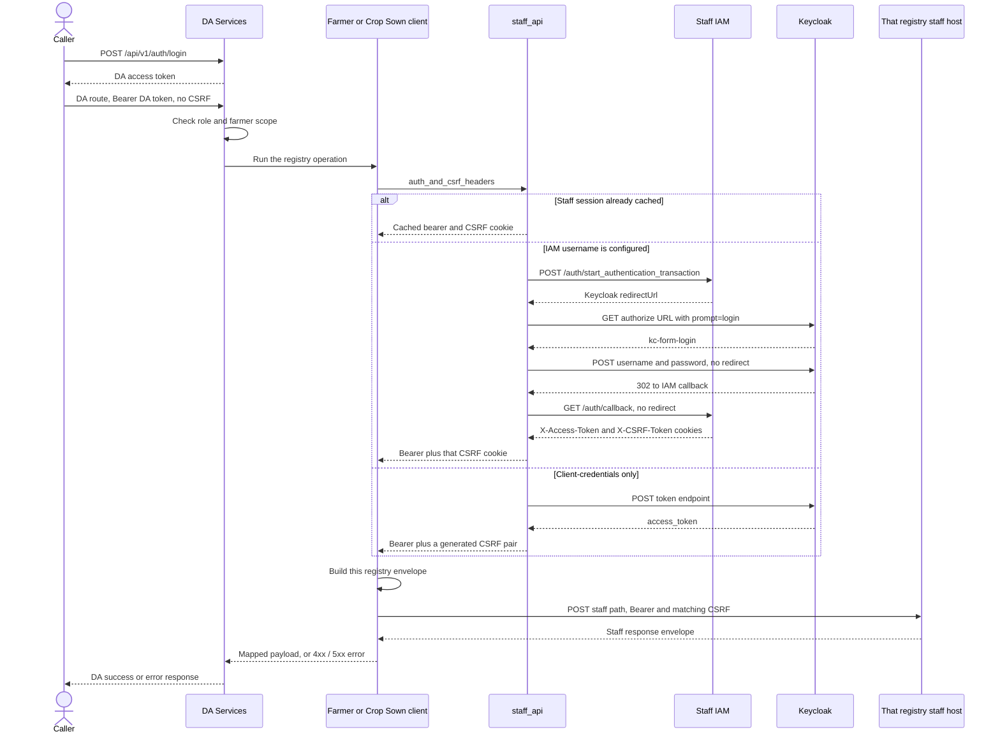
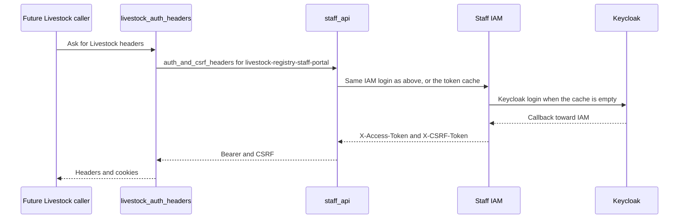

# Registry staff flow

Farmer, Crop Sown, and Livestock share one staff protocol. Each registry keeps its own site-config keys, payload shape, and field mapping. Livestock has authentication only. It does not call the Livestock host.

The DA caller authenticates with DA Services (`POST /api/v1/auth/login`). That bearer is not sent to a staff host. The registry client adds the staff bearer and the matching `X-CSRF-Token` header and cookie.

## Shared protocol

`da_services/integrations/staff_api` owns:

- IAM user login, then Keycloak client-credentials, then a static API key
- CSRF: the IAM callback cookie is reused; client-credentials and an API key get a generated pair
- the worker token cache
- the staff request envelope
- HTTP 4xx versus 5xx classification

IAM login, in the order used by the parameterized registry collection:

1. `POST {iam}/auth/start_authentication_transaction?id={login_provider_id}&redirect_uri=/en`
2. `GET` the Keycloak authorize URL with `prompt=login`
3. `POST` the `kc-form-login` action, without following the redirect
4. `GET {iam}/auth/callback`, without following the redirect, and read `X-Access-Token` and `X-CSRF-Token`

Crop Sown and Livestock also require `resource_access` roles for their portal client on that IAM token. Farmer does not add that check.

`keycloak_from_conf` picks the registry's own keycloak block when it can log in, otherwise the Farmer block.

## Farmer

DA routes live under `/api/v1/da-services/farmers`. The HTTP client is `da_services/integrations/farmer_registry/http.py`. The staff host is `farmer_registry_url`.

The envelope sender is `DA_SERVICES`. It includes `instance_id: ""`. An empty filter is `""`.

| DA call | Staff POST |
|---|---|
| Register a farmer | `/input-mechanism-data/ingest-data` |
| Ingest status | `/ingestion-data/search_in_ingestion_data` |
| Profile, plots | `/register-data/get_subject_record`, `/register-data/get_tab_records` |
| List | `/register-data/search_in_a_register` |
| Update | `/change-requests/create_change_request` |

## Crop Sown

DA routes:

- `GET /api/v1/da-services/crop-sown/intake-form`
- `GET /api/v1/da-services/crop-sown/geo-level-values`
- `GET /api/v1/da-services/farmers/{farmer_id}/crops`
- `POST /api/v1/da-services/farmers/{farmer_id}/crops`
- `POST /api/v1/da-services/farmers/{farmer_id}/crops/{submission_id}/finalize`

The HTTP client is `da_services/integrations/crop_registry/http.py`. The staff host is `crop_registry_staff_url`. There is no Crop Sown ingest API.

The envelope sender is `OAN_REGISTRY_API_TEST`. It has no `instance_id`. An empty filter is `{}`. Page size is 100.

| DA call | Staff POST |
|---|---|
| List by farmer id | `/intake-form-data/search_in_intake_form_submissions` and `/register-data/search_in_a_register` |
| Read one submission | `/intake-form-data/get_intake_form_submission` and `/intake-form-data/get_tab_records` |
| Draw one form | `/register-metadata/get_all_registers`, `/intake-form-metadata/get_all_intake_forms`, `/intake-form-metadata/render_intake_form`, `/register-metadata/get_register_fields`, then master-data `get_attribute_values` for every page of each `attribute_id` on that form |
| One geography level | Master-data `/geo/get_geo_level_values` |
| Save one section | `/intake-form-data/save_intake_form_submission` |
| Finalize | `/intake-form-data/finalize_intake_form_submission` |

`GET /crop-sown/intake-form?form=` selects planning, cultivation, sowing, or harvesting. The default is planning. The flow, hosts, and payload rules are in [crop-sown-integration.md](crop-sown-integration.md). Farmer is in [farmer-integration.md](farmer-integration.md). Livestock auth, which does not call a Livestock host, is in [livestock-integration.md](livestock-integration.md).

## Livestock

`da_services/integrations/livestock_registry/auth.py` calls `auth_and_csrf_headers` with `livestock_registry_keycloak` (or the Farmer block) and portal client `livestock-registry-staff-portal`. It returns headers and cookies. No Livestock staff URL is called, and there is no DA Livestock route.

## End-to-end sequence

The caller logs in to DA Services first. That token is checked on the DA route and is never sent to IAM or a staff host. The registry client then asks `staff_api` for a staff bearer and a matching CSRF pair, builds that registry's envelope, and only then POSTs to its own staff host.

A fresh IAM login runs only when the worker cache has no usable staff session. Later calls on that worker reuse the cached token and CSRF cookie.

Farmer posts to `farmer_registry_url` with sender `DA_SERVICES`. Crop Sown posts to `crop_registry_staff_url` with sender `OAN_REGISTRY_API_TEST`. The staff path is the one in the tables above. Crop Sown and Livestock reject an IAM token that has no roles for their portal client. Farmer does not do that check.

Livestock has no DA route and no staff POST. Its sequence stops when the headers exist:

