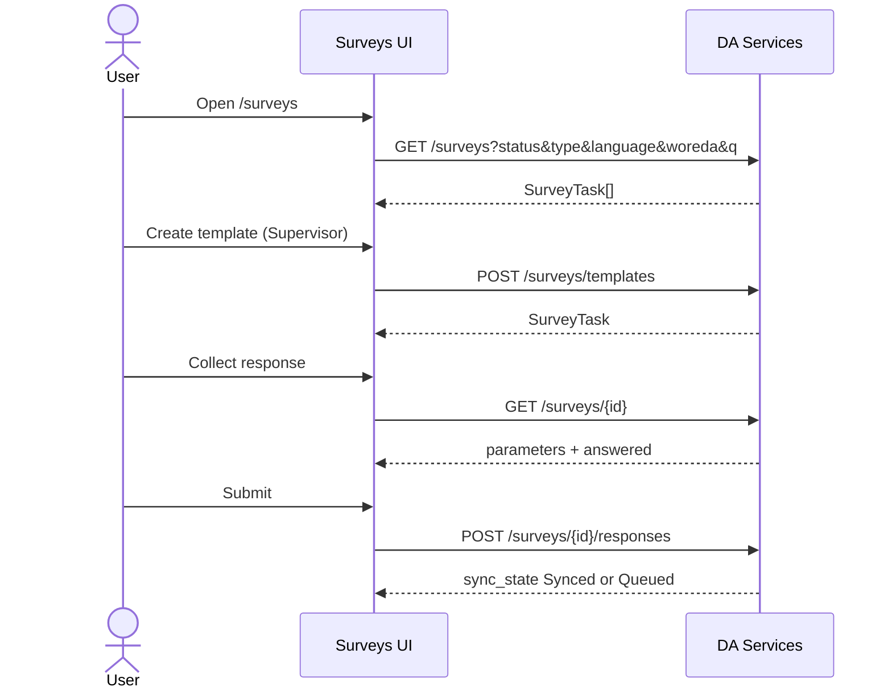

# Surveys API guide for the frontend

The Surveys screens under `/surveys` and `/surveys/[id]` should call DA Services. Today they still use seed data (`SURVEY_TASKS`) and an in-memory Zustand store (`useSurveyTemplatesStore`). Replace that with the routes below.

Prefix every path with `/api/v1/da-services`. Send `Authorization: Bearer <access_token>` and `Accept: application/json`. POST/PATCH bodies are JSON. No staff CSRF pair is required (surveys are native DocTypes, same as Visits).

Success envelope:

```json
{
  "status": "success",
  "message": "...",
  "data": {},
  "meta": { "api_version": "v1" },
  "request_id": "..."
}
```

## Screens

| Route | Component | Role |
| --- | --- | --- |
| `/surveys` | `SurveyTasks` + `CreateTemplateModal` | DA lists; Supervisor/Admin also **Create template** |
| `/surveys/[id]` | `SurveyCapture` | Capture one farmer response |

Frontend sources (mock until wired):

- `src/features/surveys/data.ts` — `SurveyTask`, `Parameter`, `ResponseStatus`
- `src/features/surveys/templates.ts` — `TemplateInput`, `templateErrors`, `surveyFromTemplate`
- `src/features/surveys/store.ts` — session-only created surveys (remove once API lands)
- `src/app/(dashboard)/surveys/...`

Nav: the backend `GET /me` menu exposes `/surveys` for **DA, Supervisor, Executive and Admin**. Communications Officer must not receive it.

## What to stop using

| Current mock | Replace with |
| --- | --- |
| `SURVEY_TASKS` seed list | `GET /surveys` |
| `getSurveyTask(id)` / Zustand `created` | `GET /surveys/{id}` |
| `surveyFromTemplate` + `useSurveyTemplatesStore.add` | `POST /surveys/templates` → use returned `SurveyTask` |
| Local `answered` Set on submit | Server `answered[]` on the task; 409 on duplicate |
| Hardcoded kebele `"Bako 01"` for auto prefill | Prefill from the selected farmer (`GET /farmers`), not a constant |

Results analysis copy on the page (“Part 2 preview”) stays a UI note. Basic aggregates are available at `GET /surveys/{id}/results` when you wire a supervisor results view.

## Field map — Create template → API

| Modal field (`TemplateInput`) | API body |
| --- | --- |
| Template name | `name` |
| Survey type | `type` (`Satisfaction` \| `Service quality` \| `Needs assessment`) |
| Opens / Closes | `open`, `close` as `yyyy-mm-dd` |
| Farmers per DA | `targetFarmers` |
| Languages checkboxes | `languages: string[]` |
| Question prompt / type / choices / required | `questions[{ prompt, type, options, required }]` — `options` may stay comma-separated string |
| Translations (Amharic / Afaan Oromoo) | `questions[].translations` — e.g. `{ "Amharic": "...", "Afaan Oromoo": "..." }`; English stays in `prompt` |
| Assignment mode | `assignmentMode`: `Woreda` (default, every DA in the Woreda) or `Selected` |
| Selected DAs | `assignedDaIds: string[]` — required when `assignmentMode = Selected`; every DA must belong to the Woreda |

Do not send consent / Farmer ID / Kebele questions. The API prepends them as `p1`–`p3`. Only custom question prompts accept `translations`; language keys are normalised to `Amharic` / `Afaan Oromoo` (aliases such as `am` / `om` are accepted). English is not duplicated in `translations`.

Client validation in `templateErrors` matches the API. On success, drop Zustand; append or refetch `GET /surveys`.

Supervisor publish resolves the target Woreda from `DA Administrative Area` and checks it against the Supervisor's **active** assignment. The Woreda may be omitted only when the Supervisor has exactly one active Woreda; otherwise send `woreda`. Region-only and Zone-only grants cover Woredas beneath them. Admin must include `woreda`; `region` / `zone` are optional consistency checks and are rejected if they do not match the hierarchy. Do not invent or cache geographic scope in the browser: the server response is authoritative.

## Field map — SurveyTask ← API

The list and detail payloads use the same camelCase names the UI already types:

| UI (`SurveyTask`) | API |
| --- | --- |
| `id` | `id` |
| `name` | `name` |
| `templateVersion` | `templateVersion` |
| `type` | `type` |
| `window.open` / `window.close` | display strings (`08 Sep 2026`) |
| — | also `window_open` / `window_close` ISO for edits |
| `languages` | `languages` |
| `targetFarmers` | `targetFarmers` |
| `collected`, `queued`, `answered` | same |
| `status` | `Open` \| `Closing soon` \| `Closed` |
| `estMinutes` | `estMinutes` |
| `assignmentMode` | `Woreda` \| `Selected` |
| `assignedDaIds` | Active DA-IDs; present on template list/detail and create/patch responses |
| `parameters[]` | `id`, `order`, `prompt`, `type`, `required`, `options?`, `helper?`, `prefill?`, `translations?`, `condition?`. `translations` maps `Amharic` / `Afaan Oromoo` to text; `prompt` is English. |

Filters on the list: `status`, `type`, `language`, `woreda`, `q`. A DA only receives `Selected` surveys where their DA-ID is actively assigned; an unassigned DA gets 403 on detail/capture.

## Farmer picker and prefill

Use the existing farmer list; do **not** add a survey-specific farmer endpoint:

```http
GET /api/v1/da-services/farmers?limit=50&start=0
```

For a DA the backend already returns only farmers in the DA's assigned Kebeles, so the
picker cannot offer an out-of-scope farmer. Use the row's `farmer_id` (canonical internal
id) as the capture value, and show `reg_id` / name for the user.

On selection, prefill the standard questions locally:

| Parameter | Prefill |
| --- | --- |
| `p2` Farmer ID | selected farmer's `reg_id` (`FR-…`) |
| `p3` Kebele | selected farmer's `kebele` |

The server overwrites `p2` / `p3` with the resolved farmer's values, so a stale prefill
cannot corrupt the response. If the farmer list returns no Kebele for a row, do not offer
that farmer: capture requires a Kebele.

## Field map — Capture → API

| Capture UI | `POST /surveys/{id}/responses` |
| --- | --- |
| Selected farmer | `farmer_id` (internal id or `FR-…`) |
| Consent granted / declined | `consent`: `granted` \| `declined` |
| Answers by parameter id | `answers`: `{ [parameterId]: string \| string[] }` |
| Submit online | omit `sync_state` or send `Synced` |
| Submit offline | `sync_state`: `Queued` |
| Declined consent | send `consent: "declined"`; the server stores `Declined` regardless of `sync_state` |
| Idempotency | `client_op_id` |

Only `Queued` and `Synced` are client-settable. `Draft` is rejected with **400**: there is no
saved-draft or draft-update flow. Do **not** send `Rejected`, `Conflict`, or `Declined` with
granted consent: those are also **400**. A declined response must send
`consent: "declined"`; the server forces `sync_state: Declined`. A survey can be captured
only from its `window_open` date through `window_close` (both inclusive). Before opening or
after closing the capture screen should be read-only; the API rejects it with 400 even if
the UI allows the request.

Rating values are strings `"1"` … `"5"`. Free text ≤ 500 characters. Multi-select is a JSON array of option strings.

`started_at` / `completed_at` are optional site-local datetimes. If supplied, completion
cannot precede start, both must be inside the window, and neither may be in the future; the
API returns 400 otherwise (no clock-skew tolerance is applied).

### Status codes to handle

| Status | Meaning | UI |
| --- | --- | --- |
| 201 | Response stored | Show success / next farmer |
| 400 | Invalid answers, unknown parameter id, capture before `window_open` / after close, invalid timestamps, invalid `sync_state`, unknown/mismatched area codes | Show the validation message |
| 403 | Farmer outside the DA's Kebele / Woreda, survey outside the caller's scope, or an expired/missing officer assignment | “This farmer is not in your assigned Kebele for this survey.” |
| 404 | Farmer not found | Ask the user to search again |
| 409 | Duplicate farmer/template, locked question edit, or unsafe `client_op_id` replay | Show “A response for this farmer already exists for this survey.” Do **not** retry with a new id |

The 409 duplicate rule is **across all DAs**. If another DA has already submitted this
farmer for the same template, the second DA gets 409 as well. Refresh the task so
`answered[]` and `collected` are up to date.

A `client_op_id` retry must reuse the exact same survey, collector, farmer, consent, sync
state and answers. The API returns the original response id for an identical retry; any
changed field is 409. Do not generate a new operation id for a retry.

Declined consent does not lock the farmer; allow another attempt. Submitted responses are
immutable, and there is no correction workflow. Historical `Draft` rows may still appear in
response lists/exports but cannot be created through the API.

Supervisor or Admin collecting on behalf of a DA must send `da_id`; the target DA's Kebele
and Woreda are enforced.

## Excel export (Supervisor / Executive / Admin)

```http
GET /api/v1/da-services/surveys/{id}/responses/export
Authorization: Bearer <access_token>
```

The response is a binary XLSX download (not the JSON envelope). Use `response.blob()`,
read `Content-Disposition` for the filename, and trigger a browser download. Do **not**
build the survey workbook in the browser.

- 200 → `application/vnd.openxmlformats-officedocument.spreadsheetml.sheet`,
  filename `survey-{id}-responses.xlsx`
- 403 → DA / Communications Officer, no live officer assignment, or a survey outside the
  caller's scope
- 404 → unknown survey

The export is gated by a **live** Supervisor / Executive assignment, not merely the role
string. A DA who also holds an expired officer role is treated as a DA and cannot export.
The workbook contains farmer identifiers and location; keep it within the officer scope
until the PII decision is confirmed.

Columns are listed in [surveys-integration.md](surveys-integration.md#excel-export-get-surveysidresponsesexport).

## Confirmed behaviour (do not build removed flows)

1. Direct submission only: send `Queued` or `Synced`; `Draft` is 400. Historical drafts
   remain read-only for display/export.
2. Create equals publish; there is no Woreda approval or separate publish step.
3. Surveys are Woreda-wide by default or individually assigned to selected DAs.
4. Custom prompts support Amharic / Afaan Oromoo `translations`; no skip logic, lookup or
   other advanced questionnaire authoring is being added.
5. Declined responses do not count towards the one-response rule; submitted responses are
   immutable and there is no correction workflow.
6. Export is complete (all base columns + all parameters); no extra filtering/column picker.

Remaining open items are engineering follow-ups only: richer field validation, clock-skew
handling, and paged/async export for large surveys.

## Sequence



## Optional supervisor APIs (no UI yet)

| Need | Route |
| --- | --- |
| Edit window / close survey | `PATCH /surveys/templates/{id}` |
| Change questions before any response | `PATCH` with `questions` (409 after `collected > 0`) |
| Change Woreda-wide / selected-DA assignment | `PATCH` with `assignmentMode` / `assignedDaIds` |
| Response list | `GET /surveys/{id}/responses?farmer_id&da_id&region&zone&woreda&kebele` |
| Basic results | `GET /surveys/{id}/results` |

## Auth and roles

| Role | List / capture | Create template | Results | XLSX export |
| --- | --- | --- | --- | --- |
| DA | yes | no | no | no |
| Supervisor | yes | yes | yes | yes |
| Admin | yes (nav + create) | yes (+ `woreda`) | yes | yes |
| Executive | list / detail / results read | no | yes | yes |
| Communications Officer | no | no | no | no |

Dual role: a user with DA plus Supervisor/Executive is treated as the officer for response
listing and export only while the officer assignment is active; otherwise they fall back to
their own DA rows and cannot export. The UI must not infer officer visibility from the role
string alone.

## Frontend repository and files for the separate PR

This repository is backend-only. The UI changes belong in the separate Next.js portal
repository (`src/features/surveys/*`, `src/app/(dashboard)/surveys/*`, `lib/rbac.ts`,
`lib/export.ts`). Required follow-up there:

1. Wire `features/surveys` to these routes; remove the `SURVEY_TASKS` seed data and Zustand store.
2. Farmer picker calls `GET /farmers`; remove `FARMERS` mock slugs.
3. Prefill `p2` / `p3` from the selected farmer, not a hardcoded Kebele.
4. Handle 400 / 403 / 404 / 409 as described above.
5. Add the server XLSX download button for Supervisor / Executive / Admin.
6. Add `/surveys` to the Executive nav in `lib/rbac.ts` if it is hard-coded there; the backend
   `GET /me` menu already includes it.
7. Sync queue entity `"Survey response"` can later POST with `sync_state: Queued` then retry as `Synced`.
8. Create modal cannot author `condition` or `lookup` questions; seed templates may still expose them on GET.
