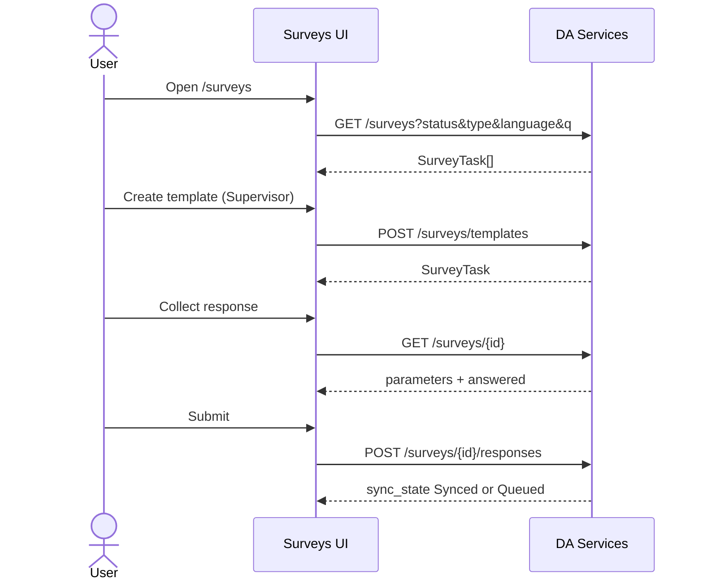

# Surveys API guide for the frontend

The Surveys screens under `/surveys` and `/surveys/[id]` should call DA Services. Today they still use seed data (`SURVEY_TASKS`) and an in-memory Zustand store (`useSurveyTemplatesStore`). Replace that with the routes below.

Prefix every path with `/api/v1/da-services`. Send `Authorization: Bearer <access_token>` and `Accept: application/json`. POST/PATCH bodies are JSON. No staff CSRF pair is required (surveys are native DocTypes, same as Visits).

Success envelope:

```json
{
  "status": "success",
  "message": "...",
  "data": {},
  "meta": { "api_version": "v1" },
  "request_id": "..."
}
```

## Screens

| Route | Component | Role |
| --- | --- | --- |
| `/surveys` | `SurveyTasks` + `CreateTemplateModal` | DA lists; Supervisor/Admin also **Create template** |
| `/surveys/[id]` | `SurveyCapture` | Capture one farmer response |

Frontend sources (mock until wired):

- `src/features/surveys/data.ts` — `SurveyTask`, `Parameter`, `ResponseStatus`
- `src/features/surveys/templates.ts` — `TemplateInput`, `templateErrors`, `surveyFromTemplate`
- `src/features/surveys/store.ts` — session-only created surveys (remove once API lands)
- `src/app/(dashboard)/surveys/...`

Nav: DA and Supervisor already; backend `GET /me` menu now also exposes `/surveys` for Admin so it matches `canCreateTemplate`.

## What to stop using

| Current mock | Replace with |
| --- | --- |
| `SURVEY_TASKS` seed list | `GET /surveys` |
| `getSurveyTask(id)` / Zustand `created` | `GET /surveys/{id}` |
| `surveyFromTemplate` + `useSurveyTemplatesStore.add` | `POST /surveys/templates` → use returned `SurveyTask` |
| Local `answered` Set on submit | Server `answered[]` on the task; 409 on duplicate |
| Hardcoded kebele `"Bako 01"` for auto prefill | Prefill from DA assignment / farmer profile when those APIs are available; still send answers for custom questions |

Results analysis copy on the page (“Part 2 preview”) stays a UI note. Basic aggregates are available at `GET /surveys/{id}/results` when you wire a supervisor results view.

## Field map — Create template → API

| Modal field (`TemplateInput`) | API body |
| --- | --- |
| Template name | `name` |
| Survey type | `type` (`Satisfaction` \| `Service quality` \| `Needs assessment`) |
| Opens / Closes | `open`, `close` as `yyyy-mm-dd` |
| Farmers per DA | `targetFarmers` |
| Languages checkboxes | `languages: string[]` |
| Question prompt / type / choices / required | `questions[{ prompt, type, options, required }]` — `options` may stay comma-separated string |

Do not send consent / Farmer ID / Kebele questions. The API prepends them as `p1`–`p3`.

Client validation in `templateErrors` matches the API. On success, drop Zustand; append or refetch `GET /surveys`.

Admin publish must include `woreda` (and may send `region` / `zone`). Supervisor scope is stamped from RBAC.

## Field map — SurveyTask ← API

The list and detail payloads use the same camelCase names the UI already types:

| UI (`SurveyTask`) | API |
| --- | --- |
| `id` | `id` |
| `name` | `name` |
| `templateVersion` | `templateVersion` |
| `type` | `type` |
| `window.open` / `window.close` | display strings (`08 Sep 2026`) |
| — | also `window_open` / `window_close` ISO for edits |
| `languages` | `languages` |
| `targetFarmers` | `targetFarmers` |
| `collected`, `queued`, `answered` | same |
| `status` | `Open` \| `Closing soon` \| `Closed` |
| `estMinutes` | `estMinutes` |
| `parameters[]` | `id`, `order`, `prompt`, `type`, `required`, `options?`, `helper?`, `prefill?`, `condition?` |

Filters on the list: `status`, `type`, `language`, `q` — same axes as `SurveyTasks` advanced filters.

## Field map — Capture → API

| Capture UI | `POST /surveys/{id}/responses` |
| --- | --- |
| Selected farmer | `farmer_id` |
| Consent granted / declined | `consent`: `granted` \| `declined` |
| Answers by parameter id | `answers`: `{ [parameterId]: string \| string[] }` |
| Save draft | `sync_state`: `Draft` (required answers not enforced) |
| Submit online | omit `sync_state` or send `Synced` |
| Submit offline | `sync_state`: `Queued` |
| Idempotency | `client_op_id` |

Rating values are strings `"1"` … `"5"`. Free text ≤ 500 characters. Multi-select is a JSON array of option strings.

On **409**, show the existing duplicate message (“one response per farmer”). Declined consent does not lock the farmer; allow another attempt.

Supervisor collecting on behalf of a DA must send `da_id`.

## Sequence



## Optional supervisor APIs (no UI yet)

| Need | Route |
| --- | --- |
| Edit window / close survey | `PATCH /surveys/templates/{id}` |
| Change questions before any response | `PATCH` with `questions` (409 after `collected > 0`) |
| Response list | `GET /surveys/{id}/responses` |
| Basic results | `GET /surveys/{id}/results` |

## Auth and roles

| Role | List / capture | Create template | Results |
| --- | --- | --- | --- |
| DA | yes | no | no |
| Supervisor | yes | yes | yes |
| Admin | yes (nav + create) | yes (+ `woreda`) | yes |
| Executive | list / detail / results read | no | yes |

## Open gaps

1. Wire `features/surveys` to these routes; remove Zustand persistence comment once live.
2. Farmer picker should use linked farmers API, not `FARMERS` mock slugs.
3. Auto Kebele / Farmer ID prefill should come from assignment and farmer profile, not hardcoding.
4. Sync queue entity `"Survey response"` can later POST with `sync_state: Queued` then retry as `Synced`.
5. Create modal cannot author `condition` or `lookup` questions; seed templates may still expose them on GET.
