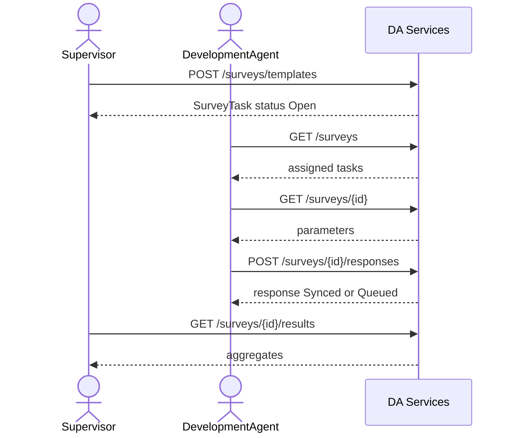

# Surveys integration

Farmer satisfaction / service quality / needs-assessment surveys (FR-09d, FSD 3.9, data-model D28). DA Services owns the data. There is no staff registry or ODK call in v1.

Supervisor or Admin publishes a template into a Woreda. That row is the assigned survey task. DAs in that Woreda list it, capture one response per farmer, and sync draft/queued/synced states. Executive reads lists, results and the Excel export in Region.

Create = publish. There is no separate Deployment DocType and no Woreda approval step in this slice. Per-DA `Survey due` task fan-out is out of scope until task generation rules are agreed.

Capture is farmer-first: the caller selects a farmer, the server resolves the canonical farmer ID, proves the farmer is in a Kebele assigned to the collector DA, checks the farmer is inside the survey's Woreda, and stores the farmer's own Region / Zone / Woreda / Kebele. The collector DA is a separate field. A client-supplied `farmer_id` is never trusted or stored verbatim.

## DocTypes

| DocType | Role |
| --- | --- |
| `DA Survey Template` | Published survey (`autoname` `DA-SRV-{YYYY}-{#######}`). API `id`. |
| `DA Survey Parameter` | Child table: questions + auto consent / Farmer ID / Kebele. |
| `DA Survey Response` | One farmer response. `duplicate_guard_key` = `{survey}\|{farmer_id}` for completed non-declined rows. |

Desk writes stay with System Manager / OAN Administrator. Runtime writes go through `services/surveys.py` with `ignore_permissions=True` after scope checks. Permission hooks: `da_survey_template_query_conditions`, `da_survey_response_query_conditions` in `da_services/permissions.py`.

## Roles

| Action | Roles |
| --- | --- |
| Create / patch template | Supervisor, OAN Administrator |
| List / get assigned surveys | DA, Supervisor, Executive, Admin |
| Submit response | DA, Supervisor (needs `da_id`), Admin |
| List responses | DA (own collector rows), Supervisor / Executive / Admin in scope |
| Results | Supervisor, Executive, Admin |
| XLSX response export | Supervisor, Executive, Admin |
| Surveys nav (`GET /me`) | DA, Supervisor, Executive, Admin |

Scope stamps `region` / `zone` / `woreda` from the creator's RBAC grant. Admin must pass `woreda` (and may pass `region` / `zone`). A DA sees templates whose woreda matches their grant. Response `da_id` is the collector DA-ID.

Farmer rules on capture:

1. `resolve_farmer_id()` accepts either the registry internal id (`farmer-uuid-…`) or the UI Farmer-ID (`FR-…`) and returns the canonical internal id.
2. The farmer must exist in `DA Farmer Reference` / the registry (404 otherwise).
3. The farmer's Kebele must be one of the collector DA's **Effective** `DA Kebele Assignment` rows, matched by code or English name (403 otherwise).
4. The farmer's Woreda must equal the collector DA's registry Woreda, and must equal the survey's Woreda when the template carries one (403 otherwise).
5. A farmer with no Kebele cannot be captured (400/validation).
6. Responses store the farmer's Region / Zone / Woreda / Kebele, never the collector DA's location.

The canonical farmer id is what is stored in `farmer_id`, what appears in `answered[]`, and what makes the duplicate guard work across ID formats.

## Routes

Prefix `/api/v1/da-services`. Bearer token only (no staff CSRF). Envelope: `success_response`.

| Method | Path | Notes |
| --- | --- | --- |
| POST | `/surveys/templates` | 201. Body = `TemplateInput`. Prepends standard params. |
| GET | `/surveys/templates` | Supervisor / Admin / Executive. Filters: `status`, `type`, `q`, `limit`, `start`. |
| GET | `/surveys/templates/{id}` | Full template including parameters. |
| PATCH | `/surveys/templates/{id}` | Partial: `name`, `open`/`close`, `languages`, `targetFarmers`, `status` Open\|Closed. `questions` only when `collected == 0` (bumps `templateVersion`); else 409. |
| GET | `/surveys` | Assigned tasks. Filters: `status`, `type`, `language`, `q`. DA `collected` / `queued` / `answered` are for that DA. |
| GET | `/surveys/{id}` | Full `SurveyTask` + `parameters`. |
| POST | `/surveys/{id}/responses` | 201. Capture / draft. Unknown farmer → 404; outside Kebele / Woreda → 403; invalid answers → 400; duplicate completed farmer → 409. |
| GET | `/surveys/{id}/responses` | Paginated. |
| GET | `/surveys/{id}/responses/export` | **XLSX download.** Supervisor / Executive / Admin. `type=download`, `application/vnd.openxmlformats-officedocument.spreadsheetml.sheet`. |
| GET | `/surveys/{id}/results` | Basic aggregates (not Part 2 analytics). |

Implementation: `da_services/api/v1/surveys.py`, `da_services/services/surveys.py`.

## Template body (`POST /surveys/templates`)

Matches the Create Template modal (`TemplateInput`):

| Field | Required | Notes |
| --- | --- | --- |
| `name` | yes | ≥ 3 characters → stored as `title`, returned as `name` |
| `type` | yes | `Satisfaction` \| `Service quality` \| `Needs assessment` |
| `open`, `close` | yes | `yyyy-mm-dd`; close ≥ open |
| `languages` | yes | subset of English, Amharic, Afaan Oromoo |
| `targetFarmers` | yes | integer ≥ 1 (farmers per DA) |
| `questions` | yes | ≥ 1; each `prompt`, `type` (rating\|single\|multi\|text), `options` (comma string or list; ≥ 2 for choice types), `required` |
| `woreda` | Admin only | required when creator is unrestricted |
| `client_op_id` | no | idempotent create |

Server prepends:

1. `p1` consent  
2. `p2` Farmer ID (`auto`, prefill Farmer Registry)  
3. `p3` Kebele (`auto`, prefill DA assignment)

Custom questions become `p4`, `p5`, …. `templateVersion` looks like `FSS-T3-v1.0`. `estMinutes` ≈ 40s per parameter, minimum 2.

## SurveyTask response shape

| API field | Source |
| --- | --- |
| `id` | DocType name |
| `name` | `title` |
| `templateVersion` | `template_version` |
| `type` | `survey_type` |
| `window.open` / `window.close` | display dates (`08 Sep 2026`) |
| `window_open` / `window_close` | ISO dates for PATCH round-trip |
| `languages` | JSON list |
| `targetFarmers` | int |
| `collected`, `queued`, `answered` | from responses (DA-scoped on list/detail when caller is DA) |
| `status` | stored `Open`/`Closed`, or derived `Closing soon` within 7 days of close, or `Closed` after close date |
| `estMinutes` | int |
| `parameters[]` | `{ id, order, prompt, type, required, options?, helper?, prefill?, condition? }` |

## Response body (`POST /surveys/{id}/responses`)

| Field | Required | Notes |
| --- | --- | --- |
| `farmer_id` | yes | Internal id or `FR-…`; resolved to the canonical id. Must be in the collector's assigned Kebele and the survey Woreda. |
| `consent` | yes except Draft | `granted` \| `declined` |
| `answers` | | map `parameter_id` → value; rating `"1"`..`"5"`; text ≤ 500; multi = list. Unknown parameter ids are rejected. |
| `sync_state` | no | default `Synced`; use `Draft` or `Queued` as needed; declined forces `Declined` |
| `started_at`, `completed_at` | no | site-local datetimes |
| `client_op_id` | no | Idempotent per `survey + collector`. Same payload returns the same row; a different payload / survey / collector is 409. |
| `da_id` | Supervisor | collector DA-ID when Supervisor captures |

The `p2` Farmer ID and `p3` Kebele auto-answers are overwritten with the resolved farmer's display ID and Kebele, so they cannot disagree with the captured farmer.

Declined consent does not set the duplicate guard; the farmer can be surveyed again. Drafts also do not set the guard. Both behaviours are unchanged pending the business decisions listed below. Closed surveys reject new responses with 400 (validation).

## Duplicate protection and idempotency

`duplicate_guard_key` is `{survey}|{canonical_farmer_id}` and is unique in the
database. A completed (`Synced` / `Queued`) granted response therefore blocks a second
response for that farmer and template **across every DA**, regardless of whether the
caller sent an internal id or an `FR-…` id.

- Same DA repeats → **409** (`SurveyConflictError`, `DUPLICATE_ENTRY`).
- Another DA repeats → **409**; no second row is written.
- Same farmer on a different template → **201**.
- Concurrent inserts that race past the pre-check are caught on the unique constraint and
  returned as **409**.
- A duplicate request never returns the existing response body.

Idempotent response replay (`client_op_id`) is scoped to the same survey **and** collector
DA. The incoming canonical farmer, consent, sync state and answers are compared with the
stored row:

| Situation | Result |
| --- | --- |
| Same `client_op_id`, same survey, same collector, identical payload | Same response id (no new row) |
| Same `client_op_id`, same survey, same collector, different payload | **409**, no row |
| Same `client_op_id` on another survey or another collector | **409**, no row and no data disclosure |

Template idempotency follows the same rule: `client_op_id` replay returns the template only
to the user who created it. A replay by another user is **409**.

## Excel export (`GET /surveys/{id}/responses/export`)

Supervisor, Executive and Admin only. The survey must be inside the caller's scope (same
check as `/results`). The response sets Frappe's `download` type, so the endpoint returns
the workbook bytes rather than the JSON envelope.

Proposed columns (all already stored on `DA Survey Response` / `DA Survey Template`):

`Response ID`, `Survey ID`, `Template Version`, `Farmer ID` (canonical), `Farmer Registry ID`
(display), `Collector DA ID`, `Consent`, `Sync State`, `Started At`, `Completed At`,
`Region`, `Zone`, `Woreda`, `Kebele`, then one column per parameter
(`p4: <prompt>`, …). Multi-select answers are comma-separated; missing answers are blank.
An empty survey produces a header-only workbook.

All stored response rows are exported exactly as recorded. Whether declined, draft or
queued rows should be filtered is still a pending business decision; no filter is applied.
Column selection, PII restrictions and async export for large surveys are also pending.

## Results (`GET /surveys/{id}/results`)

```json
{
  "survey_id": "DA-SRV-2026-0000001",
  "name": "...",
  "target_farmers": 20,
  "collected": 2,
  "queued": 0,
  "by_status": { "Synced": 2 },
  "parameters": [
    {
      "id": "p4",
      "prompt": "...",
      "type": "rating",
      "summary": { "response_count": 2, "average": 3.0, "counts": { "1": 0, "2": 1, "3": 0, "4": 1, "5": 0 } }
    }
  ]
}
```

Choice types get `summary.counts` of option → count. Consent / auto params are omitted.

## Sequence



## Tests and Postman

- Tests: `da_services/tests/test_surveys.py`
- Farmer capture helper: `da_services/tests/test_farmer_capture.py` (runs before the survey tables are migrated)
- Workbook layout: `da_services/tests/test_surveys_export.py` (pure)
- Surveys menu: `da_services/tests/test_survey_menu.py` (pure)
- Collection: `postman/Surveys/OAN-DA-Surveys.postman_collection.json`
- Environment: `postman/Surveys/OAN-DA-Surveys.postman_environment.json`

The survey DocTypes (`DA Survey Template`, `DA Survey Parameter`, `DA Survey Response`)
must be migrated before `test_surveys.py` or the live endpoints can run:

```bash
bench --site <site> migrate
```

## Pending business decisions

These are deliberately not implemented yet; existing behaviour is preserved and documented:

1. **Draft lifecycle** — can a draft be updated and submitted later, does a draft reserve the
   farmer, and does submission update the same row? Drafts currently bypass the duplicate
   guard and are insert-only.
2. **Publish workflow** — create currently equals publish (`status = Open`). A separate
   Draft → Configure → Publish step is not implemented.
3. **Advanced field validation** — only `required`, type, rating range, text length and
   option membership are enforced. Min/max, regex, dates and skip-logic authoring are not.
4. **Declined responses** — currently do not reserve the farmer and do not count as
   `collected`. Whether that is the final rule needs confirmation.
5. **Response correction** — submitted responses are immutable; there is no edit endpoint.
6. **Excel filtering/PII** — no column selection, declined/draft filtering or redaction yet.

## Out of scope (v1)

- ODK Central sync
- Separate Template vs Deployment with Woreda approval
- Per-DA `Survey due` task creation on publish
- Part 2 analytics dashboards beyond `/results`
- Authoring skip-logic / lookup questions in the create modal (seed templates may still carry `condition` / `lookup`)
