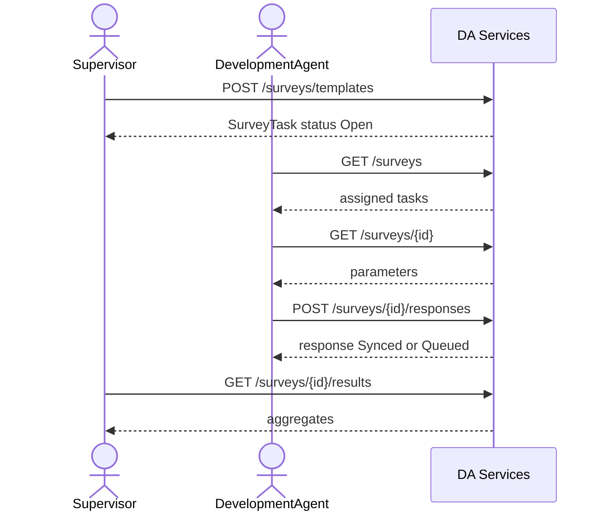

# Surveys integration

Farmer satisfaction / service quality / needs-assessment surveys (FR-09d, FSD 3.9, data-model D28). DA Services owns the data. There is no staff registry or ODK call in v1.

Supervisor or Admin publishes a template into a Woreda. The survey is available Woreda-wide by default, or the publisher may assign it to selected DAs in that Woreda. DAs list the surveys assigned to them and submit a completed response directly (online `Synced` or offline `Queued`); there is no saved-draft client state. Executive reads lists, results and the Excel export in Region.

Publishing is scoped from authoritative master data, never from the request body: the server resolves the selected Woreda in `DA Administrative Area`, derives its parent Zone and Region, rejects an incomplete or mismatched hierarchy, and then checks the derived target against the caller's **active** RBAC assignment. A Region-only or Zone-only Supervisor may publish into a Woreda that falls inside that grant; a Supervisor whose grant expired, or who has no geographic assignment, cannot publish even though the Frappe role string is still attached.

Create = publish. There is no separate Deployment DocType, no Woreda approval state and no approval workflow in this slice. Woreda-wide availability is the default. Individual assignment is recorded with marker `DA Task` rows whose `generated_by_rule` is `survey.assignment:<template>`, so the existing task DocType remains the single per-DA assignment record; there is no separate assignment DocType or field.

Capture is farmer-first: the caller selects a farmer, the server resolves the canonical farmer ID, proves the farmer is in a Kebele assigned to the collector DA, checks the farmer is inside the survey's Woreda, and stores the farmer's own Region / Zone / Woreda / Kebele. The collector DA is a separate field. A client-supplied `farmer_id` is never trusted or stored verbatim.

## DocTypes

| DocType | Role |
| --- | --- |
| `DA Survey Template` | Published survey (`autoname` `DA-SRV-{YYYY}-{#######}`). API `id`. |
| `DA Survey Parameter` | Child table: questions + auto consent / Farmer ID / Kebele. Optional `prompts_json` stores non-English prompt translations. |
| `DA Survey Response` | One farmer response. Stores the template version at capture time. `duplicate_guard_key` = `{survey}\|{farmer_id}` for completed non-declined rows. Historical `Draft` rows remain readable; new drafts are rejected. |
| `DA Task` | Existing task DocType; also stores per-DA survey assignment markers (`generated_by_rule = survey.assignment:<template>`). |

Desk writes stay with System Manager / OAN Administrator. Runtime writes go through `services/surveys.py` with `ignore_permissions=True` after scope checks. Permission hooks: `da_survey_template_query_conditions`, `da_survey_response_query_conditions` in `da_services/permissions.py`.

## Roles

| Action | Roles |
| --- | --- |
| Create / patch template | Supervisor, OAN Administrator |
| List / get assigned surveys | DA, Supervisor, Executive, Admin |
| Submit response | DA, Supervisor / Admin (need `da_id` when acting as collector); DA must be individually assigned when the survey uses `Selected` mode |
| List responses | DA (own collector rows) unless a **live** Supervisor / Executive assignment exists, in which case the officer scope applies |
| Results | Supervisor, Executive, Admin |
| XLSX response export | Supervisor, Executive, Admin with a live officer assignment |
| Surveys nav (`GET /me`) | DA, Supervisor, Executive, Admin |

Scope stamps `region` / `zone` / `woreda` from the Woreda's authoritative `DA Administrative Area` hierarchy. A non-Admin creator must have an active Supervisor assignment covering the derived Woreda. Admin must pass `woreda` (and may pass `region` / `zone` as consistency checks); those codes must exist and match the hierarchy. A DA sees Woreda-wide templates whose woreda matches their grant, plus `Selected` templates where their DA-ID is actively assigned. An unassigned DA receives 403 on survey detail/capture. Response `da_id` is the collector DA-ID.

Dual-role precedence: a user with both DA and Supervisor/Executive roles is treated as the officer for response listing and export, but **only while the officer assignment is active**. When the officer grant is expired or missing, the DA rule applies (own collector rows) and export is denied. This matches `PRIMARY_ROLE_ORDER` in `GET /me` and the response query hook; it is never the union of both roles.

Farmer rules on capture:

1. `resolve_farmer_id()` accepts either the registry internal id (`farmer-uuid-…`) or the UI Farmer-ID (`FR-…`) and returns the canonical internal id.
2. The farmer must exist in `DA Farmer Reference` / the registry (404 otherwise).
3. The farmer's Kebele must be one of the collector DA's **Effective** `DA Kebele Assignment` rows, matched by code or English name (403 otherwise).
4. The farmer's Woreda must equal the collector DA's registry Woreda, and must equal the survey's Woreda when the template carries one (403 otherwise).
5. A farmer with no Kebele cannot be captured (400/validation).
6. Responses store the farmer's Region / Zone / Woreda / Kebele, never the collector DA's location.

The canonical farmer id is what is stored in `farmer_id`, what appears in `answered[]`, and what makes the duplicate guard work across ID formats.

## Routes

Prefix `/api/v1/da-services`. Bearer token only (no staff CSRF). Envelope: `success_response`.

| Method | Path | Notes |
| --- | --- | --- |
| POST | `/surveys/templates` | 201. Body = `TemplateInput`. Prepends standard params. |
| GET | `/surveys/templates` | Supervisor / Admin / Executive. Filters: `status`, `type`, `q`, `limit`, `start`. Filters and `meta.total` use the same matched set; `Closed` includes stored-Closed and expired `Open` templates. |
| GET | `/surveys/templates/{id}` | Full template including parameters. |
| PATCH | `/surveys/templates/{id}` | Partial: `name`, `open`/`close`, `languages`, `targetFarmers`, `status` Open\|Closed, `assignmentMode` / `assignedDaIds`. `questions` with no collected responses updates the existing template and bumps `templateVersion`; with collected responses it creates a new template version containing the submitted questions and zero responses. Invalid questions → **400**. See [Template versioning on question edits](#template-versioning-on-question-edits). |
| GET | `/surveys` | Assigned tasks. Filters: `status`, `type`, `language`, `woreda`, `q`. DA `collected` / `queued` / `answered` are for that DA. Selected-assignment surveys are hidden from DAs not assigned. |
| GET | `/surveys/{id}` | Full `SurveyTask` + `parameters`. Unassigned DA → 403 in `Selected` mode. |
| POST | `/surveys/{id}/responses` | 201. Submit a completed response. Unknown farmer → 404; outside Kebele / Woreda or unassigned DA → 403; before `window_open`, after close, invalid answers, `sync_state="Draft"` or invalid client sync state → 400; duplicate completed farmer → 409. |
| GET | `/surveys/{id}/responses` | Paginated. Filters: `farmer_id`, `da_id`, `region`, `zone`, `woreda`, `kebele`. Explicit area selections are validated against the caller's scope (403), never silently widened. |
| GET | `/surveys/{id}/responses/export` | **XLSX download.** Supervisor / Executive / Admin with a live officer assignment. `type=download`, `application/vnd.openxmlformats-officedocument.spreadsheetml.sheet`. |
| GET | `/surveys/{id}/results` | Basic aggregates (not Part 2 analytics). |

Implementation: `da_services/api/v1/surveys.py`, `da_services/services/surveys.py`.

### Administrative-area filters

`GET /surveys/templates`, `GET /surveys` and `GET /surveys/{id}/responses` accept
`region` / `zone` / `woreda` / `kebele` where listed above. The server resolves each
selected code through `DA Administrative Area`, requires an active record at the right
level, and rejects unknown, inactive or out-of-scope selections with **400** / **403**.
A filter always narrows the caller's scope; it never widens it or returns unrelated rows.
Survey responses store display names for Region / Zone / Woreda / Kebele, so a Kebele
filter matches both the stored code and its English display name. Visit and farmer list
endpoints use the same scope rule (`da_services/services/area_scope.py`).

### HTTP statuses

- **400** — invalid input: missing/unknown area code, mismatched or incomplete hierarchy,
  invalid language/question/answer, capture outside the window, invalid timestamps, or a
  client-supplied `Rejected` / `Conflict` / inconsistent `Declined` state.
- **403** — role missing or target outside the caller's active scope (forged Woreda,
  expired assignment, DA attempting an officer action).
- **404** — unknown survey or farmer.
- **409** — duplicate completed response or a non-identical `client_op_id` replay
  (including cross-user / cross-collector).

## Template versioning on question edits

`PATCH /surveys/templates/{id}` handles a `questions` change according to whether the
template has collected responses:

| Collected responses | Result |
| --- | --- |
| `collected == 0` | The existing template is updated in place and its `templateVersion` is incremented. |
| `collected > 0` | A new `DA Survey Template` record is created with a new `templateVersion` and the submitted questions. The PATCH response returns the new template. |

The new version starts with `collected == 0`. The original template record remains, with
its original questions and `templateVersion`; existing responses stay linked to that
original template and to the version stored when each response was captured. Invalid
questions are rejected with **400** and do not create a new version.

Other fields included in the same PATCH (`status`, window, languages, `targetFarmers`,
name and assignment) continue to apply as before.

## Template body (`POST /surveys/templates`)

Matches the Create Template modal (`TemplateInput`):

| Field | Required | Notes |
| --- | --- | --- |
| `name` | yes | ≥ 3 characters → stored as `title`, returned as `name` |
| `type` | yes | `Satisfaction` \| `Service quality` \| `Needs assessment` |
| `open`, `close` | yes | `yyyy-mm-dd`; close ≥ open |
| `languages` | yes | subset of English, Amharic, Afaan Oromoo |
| `targetFarmers` | yes | integer ≥ 1 (farmers per DA) |
| `questions` | yes | ≥ 1; each `prompt`, `type` (rating\|single\|multi\|text), `options` (comma string or list; ≥ 2 for choice types), `required`, optional `translations` object keyed by non-English language |
| `woreda` | Supervisor / Admin | required unless the creator has exactly one active Woreda scope. Resolved from `DA Administrative Area`; the server derives Zone and Region. |
| `assignmentMode` | no | `Woreda` (default) or `Selected`. |
| `assignedDaIds` | when `Selected` | Non-empty DA-ID list. Every DA must be in the template Woreda; duplicates are removed. |
| `region`, `zone` | no | optional consistency checks for Admin (Supervisor values are derived). A code that does not exist or does not match the Woreda hierarchy is rejected with 400. |
| `client_op_id` | no | idempotent create; see below. |

A Supervisor's target is always checked against their live Supervisor assignment. Region-only and Zone-only grants cover every Woreda beneath them; a target outside the grant is rejected with **403**. Unknown, inactive or wrong-level area codes are rejected with **400**, as is an incomplete Woreda → Zone → Region tree.

Server prepends:

1. `p1` consent
2. `p2` Farmer ID (`auto`, prefill Farmer Registry)
3. `p3` Kebele (`auto`, prefill DA assignment)

Custom questions become `p4`, `p5`, …. `templateVersion` looks like `FSS-T3-v1.0`. `estMinutes` ≈ 40s per parameter, minimum 2.

## SurveyTask response shape

| API field | Source |
| --- | --- |
| `id` | DocType name |
| `name` | `title` |
| `templateVersion` | `template_version` |
| `type` | `survey_type` |
| `window.open` / `window.close` | display dates (`08 Sep 2026`) |
| `window_open` / `window_close` | ISO dates for PATCH round-trip |
| `languages` | JSON list |
| `targetFarmers` | int |
| `collected`, `queued`, `answered` | from responses (DA-scoped on list/detail when caller is DA) |
| `status` | derived: `Closed` when stored `Closed` or `window_close` has passed; `Closing soon` when the close date is within 7 days; otherwise `Open`. `Open` and `Closing soon` filters never include an expired template. |
| `estMinutes` | int |
| `assignmentMode` | `Woreda` when no active assignment markers exist, otherwise `Selected`. |
| `assignedDaIds` | Present on template list/detail and template create/patch responses; active DA-IDs only. |
| `parameters[]` | `{ id, order, prompt, type, required, options?, helper?, prefill?, translations?, condition? }`. `translations` is keyed by `English` / `Amharic` / `Afaan Oromoo` minus English; `prompt` is always English. |

`GET /surveys/templates` applies `q`, `status` (derived) and `type` before pagination, so
`meta.total` is the number of matching templates and a page never contains items filtered
out by the UI status. The same derived statuses are used by the list filter and the
returned rows.

## Response body (`POST /surveys/{id}/responses`)

| Field | Required | Notes |
| --- | --- | --- |
| `farmer_id` | yes | Internal id or `FR-…`; resolved to the canonical id. Must be in the collector's assigned Kebele and the survey Woreda. |
| `consent` | yes | `granted` \| `declined` |
| `answers` | | map `parameter_id` → value; rating `"1"`..`"5"`; text ≤ 500; multi = list. Unknown parameter ids are rejected. |
| `sync_state` | no | Client may send `Queued` or `Synced` (default `Synced`). `Draft` is rejected with **400**; historical rows are not migrated. `Declined` is forced by the server when `consent="declined"`. `Rejected`, `Conflict`, and `Declined` with granted consent are rejected with **400**. |
| `started_at`, `completed_at` | no | site-local datetimes. `completed_at` cannot precede `started_at`, both must fall inside the survey window (whole days), and neither may be in the future. Invalid ordering/window/future values are **400**. |
| `client_op_id` | no | Idempotent per `survey + collector`. Same payload returns the same row; a different payload / survey / collector is 409. The unique-constraint race path re-reads the operation row and applies the same comparison. |
| `da_id` | Supervisor / Admin | collector DA-ID when an officer collects on behalf of a DA |

The `p2` Farmer ID and `p3` Kebele auto-answers are overwritten with the resolved farmer's display ID and Kebele, so they cannot disagree with the captured farmer. The server stores the current template version on the new response as `template_version`; response list/detail objects expose it, and the client cannot set or change it.

A response can only be captured from the survey's `window_open` date (inclusive) through `window_close` (inclusive). Before opening and after closing are **400** validation errors. Declined consent does not set the duplicate guard; the farmer can be surveyed again. Historical `Draft` rows also do not set the guard. New drafts are rejected.

## Duplicate protection and idempotency

`duplicate_guard_key` is `{survey}|{canonical_farmer_id}` and is unique in the
database. A completed (`Synced` / `Queued`) granted response therefore blocks a second
response for that farmer and template **across every DA**, regardless of whether the
caller sent an internal id or an `FR-…` id. The guard applies to every non-`Declined`
response; a client cannot bypass it by supplying a server-only state. Legacy `Draft`
rows do not reserve the farmer and never receive new siblings through the API.

- Same DA repeats → **409** (`SurveyConflictError`, `DUPLICATE_ENTRY`).
- Another DA repeats → **409**; no second row is written.
- Same farmer on a different template → **201**.
- Concurrent inserts that race past the pre-check are caught on the unique constraint and
  returned as **409**.
- A duplicate request never returns the existing response body unless it is an identical
  `client_op_id` replay by the same collector.

Idempotent response replay (`client_op_id`) is scoped to the same survey **and** collector
DA. The incoming canonical farmer, consent, sync state and answers are compared with the
stored row:

| Situation | Result |
| --- | --- |
| Same `client_op_id`, same survey, same collector, identical payload | Same response id (no new row) |
| Same `client_op_id`, same survey, same collector, different payload | **409**, no row |
| Same `client_op_id` on another survey or another collector | **409**, no row and no data disclosure |
| Concurrent identical request hits the unique key | Re-read by `client_op_id`; identical payload returns the existing id, different payload is **409** |

Template idempotency follows the same rule. The incoming name, type, window, languages,
target, questions and authoritative scope are normalised and compared with the stored
template. An identical retry by the creator returns the existing template; a different
payload is **409**. A replay by another user is **409** without disclosing the template.
The concurrent unique-constraint path re-reads the operation row and compares the payload
the same way.

## Excel export (`GET /surveys/{id}/responses/export`)

Supervisor, Executive and Admin only, and the caller must have a live Supervisor or
Executive assignment. The survey must be inside that assignment's scope (same check as
`/results`). The response sets Frappe's `download` type, so the endpoint returns the
workbook bytes rather than the JSON envelope, with
`application/vnd.openxmlformats-officedocument.spreadsheetml.sheet` and filename
`survey-{id}-responses.xlsx`.

Actual columns. `Template Version` is the version stored on the response when it was
captured; `Farmer Registry ID` is resolved from `DA Farmer Reference` at export time:

`Response ID`, `Survey ID`, `Template Version`, `Farmer ID` (canonical), `Farmer Registry ID`
(display), `Collector DA ID`, `Consent`, `Sync State`, `Started At`, `Completed At`,
`Region`, `Zone`, `Woreda`, `Kebele`, then one column per parameter
(`p4: <prompt>`, …). Multi-select answers are comma-separated; missing answers are blank.
An empty survey produces a header-only workbook.

`DA Survey Response.template_version` is written from the template when the response is
first created and is not changed by later template edits, idempotent replays or sync-state
handling. The export reads that stored value, so a response is never relabelled with the
template's current version. Responses created before the field existed keep a blank
`Template Version` cell; export does not backfill them with the current template version.

All stored response rows are exported exactly as recorded, including declined, queued and historical `Draft` rows. No status filter or column selection is applied: the workbook contains the base columns plus one column for every parameter, so the complete response is represented. PII restrictions and async export for large surveys remain open.

Export loads the entire survey and the farmer reference rows into memory. That is fine for
the current expected volumes but is a production risk for very large surveys; a future
change should page or stream the response rows and move the workbook build to the long
queue. The workbook contains canonical/display farmer identifiers and location and must
stay behind the officer scope until the PII decision is confirmed.

## Results (`GET /surveys/{id}/results`)

```json
{
  "survey_id": "DA-SRV-2026-0000001",
  "name": "...",
  "target_farmers": 20,
  "collected": 2,
  "queued": 0,
  "by_status": { "Synced": 2 },
  "parameters": [
    {
      "id": "p4",
      "prompt": "...",
      "type": "rating",
      "summary": { "response_count": 2, "average": 3.0, "counts": { "1": 0, "2": 1, "3": 0, "4": 1, "5": 0 } }
    }
  ]
}
```

Choice types get `summary.counts` of option → count. Consent / auto params are omitted.

## Sequence



## Tests and Postman

- Tests: `da_services/tests/test_surveys.py`
- Farmer capture helper: `da_services/tests/test_farmer_capture.py` (runs before the survey tables are migrated)
- Workbook layout: `da_services/tests/test_surveys_export.py` (pure)
- Surveys menu: `da_services/tests/test_survey_menu.py` (pure)
- Collection: `postman/Surveys/OAN-DA-Surveys.postman_collection.json`
- Environment: `postman/Surveys/OAN-DA-Surveys.postman_environment.json`
- Live run:
  [surveys-live-api-test-2026-11-09.md](surveys-live-api-test-2026-11-09.md)
  — 47/47 live checks passed against the local site (port 8000), including assignment
  switching and area-scope rejection. The older
  [2026-11-06 run](surveys-live-api-test-2026-11-06.md) is historical evidence for the
  pre-change contract.

The checked-in environment's `base_url` is `http://127.0.0.1:8200`; the local
bench used for the 2026-11-06 live run listened on port 8000. Override `base_url`
at run time. The checked-in environment has no credentials; set the account
variables locally and do not commit them.

The collection's main flow uses the Supervisor/Admin token. Set `da_id` to the
collector DA in the survey Woreda whose Kebele assignment contains `farmer_id`;
all capture requests send it. A DA-only token may leave `da_id` empty because the
server uses the DA's own assignment. The dedicated DA login request only seeds
`da_access_token` for the export-403 check; to capture as a DA, run the main
`Login` request with `da_usr` / `da_pwd` so it replaces `access_token`.

Set `outside_kebele_farmer_id` to a farmer in the same Woreda but outside
`da_id`'s Kebele. The request fails in pre-request rather than sending an empty
farmer id. Set `other_da_usr` / `other_da_pwd` to a second DA in the same
Woreda/Kebele for the cross-DA duplicate.

The survey DocTypes (`DA Survey Template`, `DA Survey Parameter`, `DA Survey Response`)
must be migrated before `test_surveys.py` or the live endpoints can run:

```bash
bench --site <site> migrate
```

## Confirmed decisions (implemented)

1. **Direct submission only** — clients send `Queued` or `Synced`; `Draft` is rejected with
   **400**. Historical Draft rows are preserved and remain readable/exported, but there is
   no saved-draft or draft-update flow.
2. **No survey approval workflow** — create equals publish (`status = Open`); there is no
   Woreda approval state, `approved_by` field or separate publication step.
3. **Woreda-wide or selected-DA assignment** — default is every DA in the Woreda. Selected
   assignment validates that each DA belongs to the Woreda and is enforced on survey
   list/detail and capture. Active assignment markers are `DA Task` rows; removing an
   assignment cancels its marker and re-assigning creates a new marker.
4. **Multilingual questions** — custom prompts accept `translations` for Amharic and Afaan
   Oromoo (English stays in `prompt`). Language aliases are normalised to the canonical
   names. Skip logic, lookup, prefill and other advanced questionnaire features are not
   being added.
5. **Declined responses** — do not reserve the farmer and do not count as `collected`.
   There is no additional declined-response or correction workflow; submitted responses
   remain immutable.
6. **Excel export** — exports the complete stored response (base columns plus all
   parameters), with no new status filter, column picker or PII rules.

## Remaining open items

- **Advanced field validation** — only `required`, type, rating range, text length and
  option membership are enforced. Min/max, regex, dates and skip-logic authoring are not.
- **Clock-skew tolerance** — no tolerance is applied to client timestamps: anything later
  than the server's current time is rejected. Revisit if field devices are shown to have
  material clock drift.
- **Export at scale** — the workbook is built in memory; paging/streaming and async export
  remain engineering follow-ups.

## Out of scope (v1)

- ODK Central sync
- Separate Template vs Deployment with Woreda approval
- Automatic `Survey due` task creation for Woreda-wide surveys (markers are created only
  for selected individual assignments)
- Part 2 analytics dashboards beyond `/results`
- Authoring skip-logic / lookup questions in the create modal (seed templates may still carry `condition` / `lookup`)
