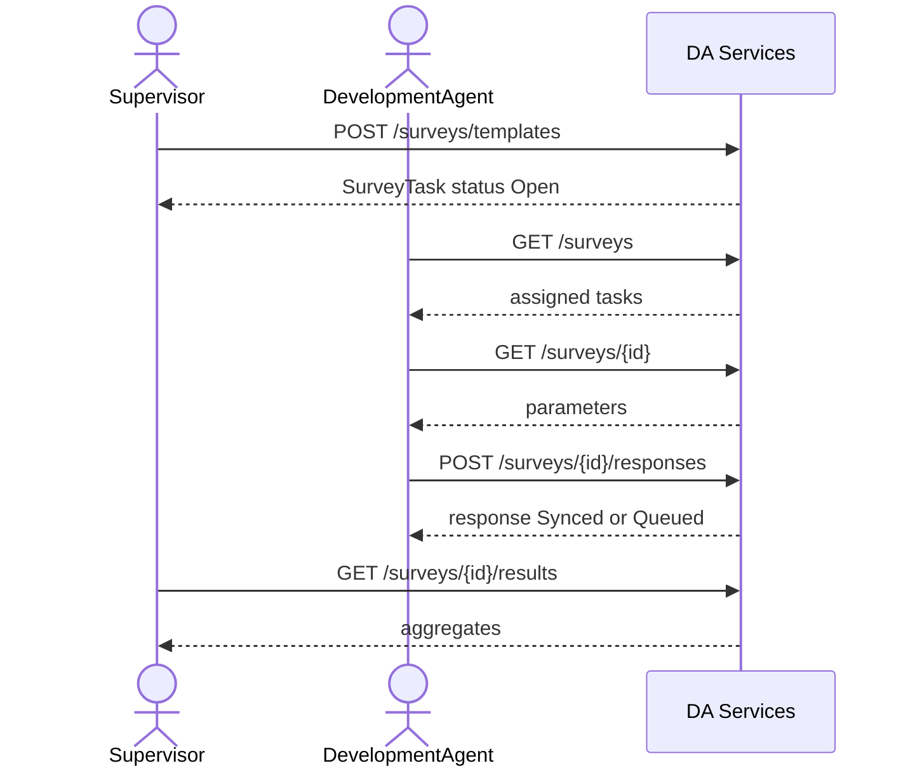

# Surveys integration

Farmer satisfaction / service quality / needs-assessment surveys (FR-09d, FSD 3.9, data-model D28). DA Services owns the data. There is no staff registry or ODK call in v1.

Supervisor or Admin publishes a template into a Woreda. That row is the assigned survey task. DAs in that Woreda list it, capture one response per farmer, and sync draft/queued/synced states. Executive reads lists and results in Region.

Create = publish. There is no separate Deployment DocType and no Woreda approval step in this slice. Per-DA `Survey due` task fan-out is out of scope until task generation rules are agreed.

## DocTypes

| DocType | Role |
| --- | --- |
| `DA Survey Template` | Published survey (`autoname` `DA-SRV-{YYYY}-{#######}`). API `id`. |
| `DA Survey Parameter` | Child table: questions + auto consent / Farmer ID / Kebele. |
| `DA Survey Response` | One farmer response. `duplicate_guard_key` = `{survey}\|{farmer_id}` for completed non-declined rows. |

Desk writes stay with System Manager / OAN Administrator. Runtime writes go through `services/surveys.py` with `ignore_permissions=True` after scope checks. Permission hooks: `da_survey_template_query_conditions`, `da_survey_response_query_conditions` in `da_services/permissions.py`.

## Roles

| Action | Roles |
| --- | --- |
| Create / patch template | Supervisor, OAN Administrator |
| List / get assigned surveys | DA, Supervisor, Executive, Admin |
| Submit response | DA, Supervisor (needs `da_id`), Admin |
| List responses | DA (own collector rows), Supervisor / Executive / Admin in scope |
| Results | Supervisor, Executive, Admin |

Scope stamps `region` / `zone` / `woreda` from the creator's RBAC grant. Admin must pass `woreda` (and may pass `region` / `zone`). A DA sees templates whose woreda matches their grant. Response `da_id` is the collector DA-ID.

## Routes

Prefix `/api/v1/da-services`. Bearer token only (no staff CSRF). Envelope: `success_response`.

| Method | Path | Notes |
| --- | --- | --- |
| POST | `/surveys/templates` | 201. Body = `TemplateInput`. Prepends standard params. |
| GET | `/surveys/templates` | Supervisor / Admin / Executive. Filters: `status`, `type`, `q`, `limit`, `start`. |
| GET | `/surveys/templates/{id}` | Full template including parameters. |
| PATCH | `/surveys/templates/{id}` | Partial: `name`, `open`/`close`, `languages`, `targetFarmers`, `status` Open\|Closed. `questions` only when `collected == 0` (bumps `templateVersion`); else 409. |
| GET | `/surveys` | Assigned tasks. Filters: `status`, `type`, `language`, `q`. DA `collected` / `queued` / `answered` are for that DA. |
| GET | `/surveys/{id}` | Full `SurveyTask` + `parameters`. |
| POST | `/surveys/{id}/responses` | 201. Capture / draft. Duplicate completed farmer → 409. |
| GET | `/surveys/{id}/responses` | Paginated. |
| GET | `/surveys/{id}/results` | Basic aggregates (not Part 2 analytics). |

Implementation: `da_services/api/v1/surveys.py`, `da_services/services/surveys.py`.

## Template body (`POST /surveys/templates`)

Matches the Create Template modal (`TemplateInput`):

| Field | Required | Notes |
| --- | --- | --- |
| `name` | yes | ≥ 3 characters → stored as `title`, returned as `name` |
| `type` | yes | `Satisfaction` \| `Service quality` \| `Needs assessment` |
| `open`, `close` | yes | `yyyy-mm-dd`; close ≥ open |
| `languages` | yes | subset of English, Amharic, Afaan Oromoo |
| `targetFarmers` | yes | integer ≥ 1 (farmers per DA) |
| `questions` | yes | ≥ 1; each `prompt`, `type` (rating\|single\|multi\|text), `options` (comma string or list; ≥ 2 for choice types), `required` |
| `woreda` | Admin only | required when creator is unrestricted |
| `client_op_id` | no | idempotent create |

Server prepends:

1. `p1` consent  
2. `p2` Farmer ID (`auto`, prefill Farmer Registry)  
3. `p3` Kebele (`auto`, prefill DA assignment)

Custom questions become `p4`, `p5`, …. `templateVersion` looks like `FSS-T3-v1.0`. `estMinutes` ≈ 40s per parameter, minimum 2.

## SurveyTask response shape

| API field | Source |
| --- | --- |
| `id` | DocType name |
| `name` | `title` |
| `templateVersion` | `template_version` |
| `type` | `survey_type` |
| `window.open` / `window.close` | display dates (`08 Sep 2026`) |
| `window_open` / `window_close` | ISO dates for PATCH round-trip |
| `languages` | JSON list |
| `targetFarmers` | int |
| `collected`, `queued`, `answered` | from responses (DA-scoped on list/detail when caller is DA) |
| `status` | stored `Open`/`Closed`, or derived `Closing soon` within 7 days of close, or `Closed` after close date |
| `estMinutes` | int |
| `parameters[]` | `{ id, order, prompt, type, required, options?, helper?, prefill?, condition? }` |

## Response body (`POST /surveys/{id}/responses`)

| Field | Required | Notes |
| --- | --- | --- |
| `farmer_id` | yes | |
| `consent` | yes except Draft | `granted` \| `declined` |
| `answers` | | map `parameter_id` → value; rating `"1"`..`"5"`; text ≤ 500; multi = list |
| `sync_state` | no | default `Synced`; use `Draft` or `Queued` as needed; declined forces `Declined` |
| `started_at`, `completed_at` | no | site-local datetimes |
| `client_op_id` | no | idempotent |
| `da_id` | Supervisor | collector DA-ID when Supervisor captures |

Declined consent does not set the duplicate guard; the farmer can be surveyed again. Closed surveys reject new responses.

## Results (`GET /surveys/{id}/results`)

```json
{
  "survey_id": "DA-SRV-2026-0000001",
  "name": "...",
  "target_farmers": 20,
  "collected": 2,
  "queued": 0,
  "by_status": { "Synced": 2 },
  "parameters": [
    {
      "id": "p4",
      "prompt": "...",
      "type": "rating",
      "summary": { "response_count": 2, "average": 3.0, "counts": { "1": 0, "2": 1, "3": 0, "4": 1, "5": 0 } }
    }
  ]
}
```

Choice types get `summary.counts` of option → count. Consent / auto params are omitted.

## Sequence



## Tests and Postman

- Tests: `da_services/tests/test_surveys.py`
- Collection: `postman/Surveys/OAN-DA-Surveys.postman_collection.json`
- Environment: `postman/Surveys/OAN-DA-Surveys.postman_environment.json`

Migrate DocTypes before a live run: `bench --site <site> migrate`.

## Out of scope (v1)

- ODK Central sync
- Separate Template vs Deployment with Woreda approval
- Per-DA `Survey due` task creation on publish
- Part 2 analytics dashboards beyond `/results`
- Authoring skip-logic / lookup questions in the create modal (seed templates may still carry `condition` / `lookup`)
