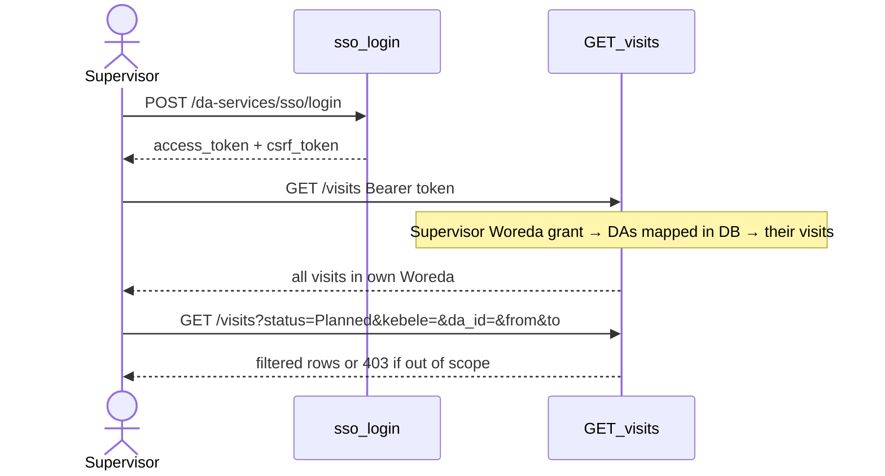

# Visits list — frontend guide (DA-383)

Wire the Supervisor `/visits` screen (and DA list from the dashboard tile) to DA Services.
Backend contract: [visits-integration.md](visits-integration.md). Screen map: [api-da-screens.md](api-da-screens.md) §2.7.
Postman: `postman/Visits/OAN-DA-Visits.postman_collection.json`.

## Frontend paths (portal)

| Concern | Path |
| --- | --- |
| Route `/visits` | `src/app/(dashboard)/visits/page.tsx` |
| Table + filters + `listVisits` load | `src/app/(dashboard)/visits/components/VisitsTable.tsx` |
| Stats tiles (still mock) | `src/app/(dashboard)/visits/components/VisitsStats.tsx` |
| API client + `ApiVisit` / `toVisitRecord` | `src/features/visits/api.ts` |
| `VisitRecord` / `VisitStatus` types | `src/features/visits/types.ts` |
| Mock `VISIT_STATS` | `src/features/visits/data.ts` |
| Roles / nav | `src/lib/rbac.ts` |

`VisitsTable` already calls `GET /da-services/visits` via `listVisits` (`src/features/visits/api.ts`). Scope is enforced by the Bearer token; do not send a client role flag. For a Supervisor, omit `da_id` to get all visits for DAs mapped to the Woreda in Frappe (RBAC + live kebele in Proposed/Validated/Flagged/Effective).

## Setup

| | |
|---|---|
| Base URL (local) | `http://127.0.0.1:8200` |
| Route prefix | `/api/v1/da-services` |
| Auth | `Authorization: Bearer <access_token>` |
| Accept | `application/json` |

Login (SSO, same as Crop Sown):

```http
POST /api/v1/da-services/sso/login
Content-Type: application/json

{"username":"<supervisor-or-da>","password":"<password>","key":"<sso_key>"}
```

Use `data.access_token` as `Authorization: Bearer …` on every call. Send `X-CSRF-Token: <data.csrf_token>` when the client already holds it (Postman collection does). **Role comes from the token / session** — never send `role` or `is_supervisor` on the visits API.

When a Supervisor **plans** a visit, always send `da_id` (the DA in their Woreda). DAs may omit it (self-plan).

## Sequence (Supervisor)



1. SSO Login as Supervisor (`username` / `password` / `key`).
2. `GET /visits` with no status → planned + completed + history for **mapped DAs in own Woreda**.
3. Optional filters on the **same** URL: `status`, `kebele`, `da_id`, `date` or `from`+`to`.
4. Do not request another Woreda; the API returns 403.

## UI field map

`toVisitRecord` in `src/features/visits/api.ts` maps API → `VisitRecord` (`src/features/visits/types.ts`):

| `VisitRecord` (FE) | API field |
| --- | --- |
| `id` | `name` |
| `agent` | `da_id` |
| `farmerId` / `farmerName` | `farmer_id` (name not on list payload yet; FE uses id as name) |
| `status` | `ui_status` (Planned / Confirmed / Completed / Missed) |
| `physicalStatus` | `physical_status` |
| `date` / `time` | derived from `scheduled_at` |
| `kebele` | `kebele` |
| `purpose` | `purpose` or `visit_type` |
| `assignedBy` | `assigned_by` |
| `plotRef` | `plot_ref` |
| `durationMin` | `duration_min` |

`VisitQuery` in `api.ts` today: `date`, `from`, `to`, `status`, `da_id`, `farmer_id`, `limit`, `start`. Backend also accepts `kebele` / `woreda` / `region` / `zone` for Supervisor filters — pass those query params when the advanced drawer needs them (`VisitsTable` currently filters agent/kebele/status **client-side** after load).

## What the page must stop assuming

| FE assumption | Reality |
| --- | --- |
| `GET /visits?q=` or `agent=` | Not implemented — use `da_id` for agent filter |
| Response `stats` / `VISIT_STATS` (`VisitsStats.tsx` / `data.ts`) | Not returned by this list API — still mock |
| Client sends role | Role is from the Bearer token only (`useAuthStore`) |
| Empty list for other Woreda | Out-of-scope area → **403** |
| Visit list follows `/agents` (registry) | No — Supervisor list uses Frappe DA↔Woreda mapping (RBAC + live kebele incl. Proposed) |
| DA must always pass `da_id` (`VisitsTable` TEMP comment) | Supervisor must **omit** `da_id` for full Woreda history; DA may pass own `da_id` |

## Example calls

All visits in scope (Supervisor = full Woreda history):

```http
GET /api/v1/da-services/visits?limit=50&start=0
```

Planned open visits for one Kebele:

```http
GET /api/v1/da-services/visits?status=Planned&kebele=ET04-W01-K03&from=2026-11-10&to=2026-11-17
```

One agent:

```http
GET /api/v1/da-services/visits?da_id=DA-000002
```

Completed only:

```http
GET /api/v1/da-services/visits?status=Completed
```
